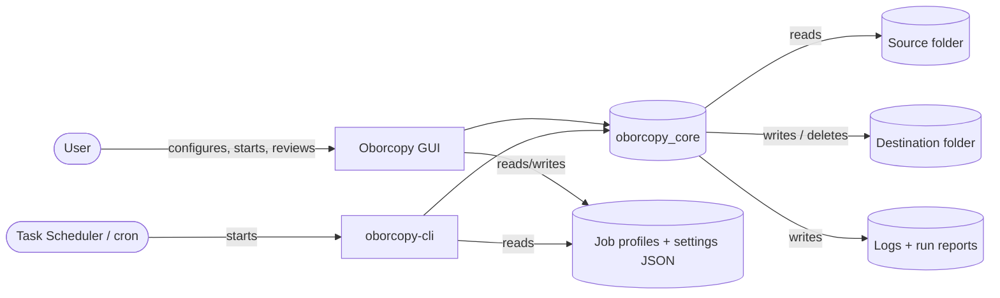
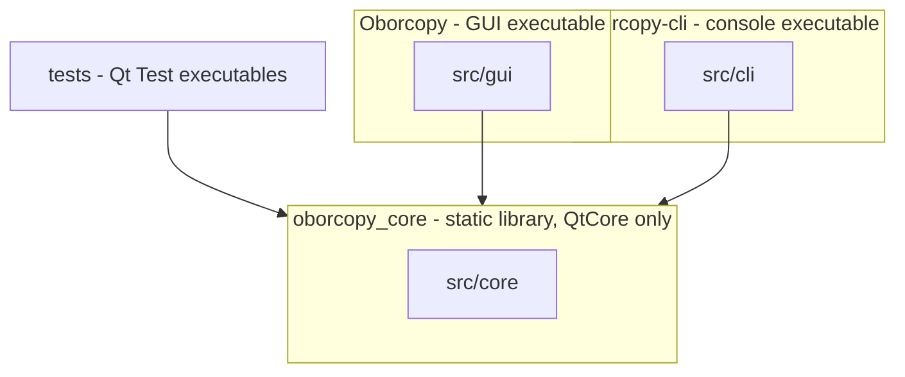
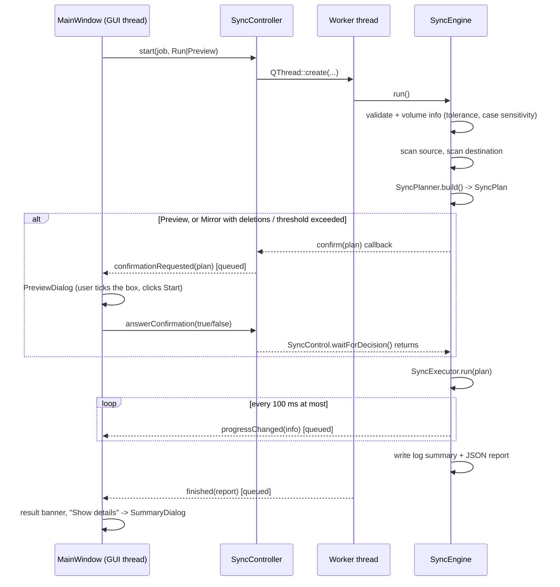

# Oborcopy – Software Architecture Document

| | |
|---|---|
| Document version | 1.3 |
| Software version | 1.1.1 |
| Last updated | 2026-10-24 |
| Status | Living document – updated with every milestone |

---

## 1. Introduction

### 1.1 Purpose
Oborcopy is a desktop tool for **incremental copying and mirroring of folders**, with a graphical user interface and a command-line companion. It offers the most important capabilities of *Robocopy* (Windows) and *rsync* (Linux) in an easy-to-use, safe form.

This document describes the architecture: building blocks, run-time behaviour, data formats, design decisions and quality measures. It is also the basis for the User Guide.

### 1.2 Primary use case
> An offline music collection lives on disk A. Once a week, a backup disk B is updated so that it contains **exactly** the same data set (incremental copy plus deletion of files that no longer exist in the source).

### 1.3 Scope of version 1.0.0
* GUI application `Oborcopy` and command-line tool `oborcopy-cli` (Windows 10/11, Linux)
* Modes **Update** (copy new/changed files) and **Mirror** (Update + delete extras)
* Preview / dry run, confirmation before deletions, deletion threshold, archive instead of delete
* FAT/exFAT timestamp tolerance, DST tolerance, optional checksum comparison and verification
* Retry with exponential backoff for locked files, pause / resume / cancel
* Live progress, log file per run, JSON run report, detailed tree summary, run history
* Named job profiles in JSON, light/dark theme

Out of scope for 1.0: NTFS ACL/owner copying, network-protocol transports (SSH), built-in scheduler (the OS scheduler runs `oborcopy-cli` instead), delta-transfer within files.

### 1.4 Definitions
| Term | Meaning |
|---|---|
| Job | A saved set of options: source, destination, mode, filters, … |
| Run | One execution of a job |
| Plan | List of actions computed from the scans before anything is changed |
| Extra | An item that exists in the destination but not in the source |
| Tolerance | Maximum timestamp difference that still counts as "equal" |

---

## 2. Requirements and quality goals

### 2.1 Functional requirements (summary)
| ID | Requirement | Realised by |
|---|---|---|
| F1 | Copy new and changed files (incremental) | `SyncPlanner`, `SyncExecutor` |
| F2 | Mirror: delete extras in the destination | `SyncPlanner::planDeletions` |
| F3 | Confirmation / preview before deletions | `PreviewDialog`, `SyncCallbacks::confirm` |
| F4 | Progress display, never-freezing GUI, pause, cancel | `ProgressTracker`, `SyncController`, `SyncControl` |
| F5 | Retry of locked files with backoff, configurable retries | `RetryPolicy`, `SyncExecutor::withRetry` |
| F6 | FAT/exFAT 2-second timestamp tolerance | `FsInfo`, `FileComparator` |
| F7 | Log file per run + summary line | `RunLogger`, `RunReport::summaryLine` |
| F8 | Detailed summary as a tree (copied / updated / deleted / errors) | `SummaryDialog`, `ResultTreeView` |
| F9 | Basic and Advanced options | `BasicOptionsPage`, `AdvancedOptionsPage` |
| F10 | JSON persistence of options | `JobJson`, `JobStore`, `AppSettings` |
| F11 | About dialog with version and build date | `AboutDialog`, `AppInfo`, `cmake/BuildInfo.cmake` |
| F12 | Unattended weekly runs | `oborcopy-cli` + Task Scheduler / cron |

### 2.2 Quality goals
| Priority | Quality | Scenario |
|---|---|---|
| 1 | **Data safety** | A wrong or empty source folder must never silently wipe the backup. An interrupted run must never leave a half-written file under the real name. |
| 2 | **Reliability** | A locked file is retried and, if it stays locked, reported – the run continues with the other files. |
| 3 | **Usability** | A first-time user can set up the weekly music backup on the Basic tab only. |
| 4 | **Responsiveness** | The GUI reacts within 100 ms at all times, even while copying 100,000 files. |
| 5 | **Maintainability** | Small classes and functions (mostly ≤ 60 lines), core logic free of GUI code and covered by automated tests. |
| 6 | **Portability** | One code base for Windows and Linux; minimum Qt 6.4. |

### 2.3 Constraints
* C++20, Qt 6 (Core, Gui, Widgets; Test for tests), CMake ≥ 3.21, Ninja
* Windows: Qt 6.10.2 MinGW 64-bit kit (`C:\Qt\6.10.2\mingw_64`), MinGW 13.1
* Linux: Ubuntu 24.04 system Qt (6.4) – built and tested in Docker
* No third-party libraries besides Qt

---

## 3. System context



---

## 4. Solution strategy

| Goal | Approach |
|---|---|
| Data safety | **Plan first, act later**: everything is scanned and compared before the first change. Mirror deletions need explicit confirmation (GUI checkbox / CLI `--yes`). A deletion threshold and an "empty source" guard catch wrong folders. Copies go to a temporary file and are renamed atomically. Optional archive folder instead of permanent deletion. |
| Reliability | Every file operation runs through one retry loop with exponential backoff and jitter; failures become report items, not aborts. |
| Responsiveness | The engine runs in a worker thread; it talks to the GUI only through queued signals; progress is throttled to 10 updates/s. |
| Maintainability | Three layers: **core** (QtCore only, no GUI), **gui**, **cli**. Core components are small single-purpose classes with unit and integration tests. |
| Usability | Basic tab with large mode cards, sensible defaults (auto tolerance, 3 retries, OS folders excluded), preview everywhere. |

---

## 5. Building block view

### 5.1 Level 1 – targets



| Target | Folder | Responsibility |
|---|---|---|
| `oborcopy_core` | `src/core` | Options, persistence, scanning, comparison, planning, copying, logging, reporting. No widgets. |
| `Oborcopy` | `src/gui` | Qt Widgets application (Windows: `Oborcopy.exe`, Linux: `oborcopy`). |
| `oborcopy-cli` | `src/cli` | Console front end for scripted/scheduled runs. Separate executable because a Windows GUI-subsystem program cannot reliably write to the calling console or make it wait. |
| `oborcopy-service` | `src/service` | Oborcopy Scheduler: Windows service / systemd user service that runs scheduled jobs through `oborcopy-cli` (see 5.5). QtCore only. |
| `tst_*` | `tests` | Unit and integration tests (CTest). |

### 5.2 Level 2 – core (`src/core`)

| Component | Responsibility |
|---|---|
| `JobOptions` | Plain option structs (`FilterOptions`, `CopyOptions`, `MetadataOptions`, `CompareOptions`, `RetryOptions`, `SafetyOptions`, `LogOptions`) and defaults |
| `JobJson` | JSON ⇄ `JobOptions`; missing keys fall back to defaults |
| `JobStore` | One JSON file per job in the jobs folder; list/load/save/rename/remove |
| `AppSettings` | Theme, last job, window geometry (`settings.json`) |
| `AppPaths` | Config, jobs and log locations; `OBORCOPY_CONFIG_DIR` override |
| `AppInfo` | Name, version, build date, Qt version, compiler |
| `JobValidator` | Pre-run checks (folders exist, destination not inside source, …) |
| `FsInfo` | Volume info (`QStorageInfo`): file system, free space, FAT detection, auto tolerance, case sensitivity |
| `PathFilter` | Include/exclude wildcards, size/age limits, hidden/system attributes |
| `FileScanner` | Recursive directory walk → `ScanResult` (files and folders keyed by relative path) |
| `FileComparator` | Size + modification time with tolerance and optional DST tolerance |
| `Hash` | Streamed SHA-256 (checksum comparison and verification) |
| `SyncPlanner` | Two scans → `SyncPlan` (create dirs, copy, update, delete, threshold) |
| `SyncControl` | Thread-safe pause / resume / cancel / confirmation channel |
| `RetryPolicy` | Backoff schedule |
| `Throttle` | Optional bandwidth limit shared by all copy threads |
| `FileCopier` | Safe single-file copy (temp file → flush → timestamp → atomic rename → attributes) |
| `SyncExecutor` | Executes a plan (deletions, folders, parallel copies, folder times) via the retry loop |
| `ProgressTracker` | Aggregates progress, computes speed and ETA (pause excluded), throttles callbacks |
| `RunReport` | Result items + statistics; JSON (de)serialisation; summary line |
| `ReportSink` | Thread-safe entry point for results → report, log, live counters |
| `RunLogger` | Log file per run, log levels, rotation, writes the JSON report next to the log |
| `Platform` | OS specifics: Windows attributes, atomic replace (`MoveFileExW`), directory times, `fsync` / `FlushFileBuffers`, long paths |
| `SyncEngine` | Orchestrates a whole run; the only class the front ends call |

### 5.3 Level 2 – GUI (`src/gui`)

| Component | Responsibility |
|---|---|
| `MainWindow` | Layout (sidebar, job header, options/progress stack, action bar), menus, auto-save, run control |
| `JobListWidget` | Sidebar job list: new, duplicate, rename, delete |
| `PathPicker` | Folder field with browse button, drag & drop and drive info (volume name, file system, free space) |
| `BasicOptionsPage` | Mode cards (Update/Mirror), subfolders, retries, time tolerance, excludes, dry run |
| `AdvancedOptionsPage` | Collapsible sections: copy behaviour, comparison, filters, metadata, retry timing, mirror safety, logging |
| `SyncController` | Owns the worker `QThread` and the `SyncControl`; relays engine callbacks as queued signals |
| `ProgressPanel` | Phase, overall and per-file progress, speed, ETA, counters, activity log, result banner |
| `PreviewDialog` | Shows the plan; deletion warnings; confirmation checkbox gates "Start sync" |
| `ResultTreeView` | Folder tree of results with filter chips and search (shared by preview and summary) |
| `SummaryDialog` | Statistics tiles, result tree, error detail pane, CSV export, open log |
| `HistoryDialog` | Lists previous runs from the JSON reports |
| `AboutDialog` | Version, build date, Qt version, compiler, platform |
| `Theme`, `IconFactory`, `ModeCard`, `CollapsibleSection`, `GuiUtil` | Look & feel: Fusion style with light/dark palette and style sheet, runtime-painted vector icons, reusable widgets, formatting helpers |

### 5.4 Level 2 – CLI (`src/cli`)
`CliRunner` parses options, loads the job (by name or file), runs `SyncEngine` with console callbacks and maps the result to an exit code. Hidden options for the scheduler: `--scheduled` marks the report (`"trigger": "scheduled"`), `--stdin-control` cancels the run when `cancel` or end-of-input arrives on stdin.

### 5.5 Level 2 – Scheduler service (`src/service`)

```
Oborcopy (GUI, ServiceController) ──writes──> <configDir>/service/schedule.json
            │  ◄──reads──── status.json (activity, heartbeat, current job, next runs)
            │  ◄──reads──── state.json  (anchor, last run, result per job)
            │  control: Windows SCM API  |  systemctl --user (+ SIGUSR1/2 for pause/resume)
            ▼
oborcopy-service (Scheduler loop) ──QProcess──> oborcopy-cli --job <name> --quiet --scheduled --stdin-control [--yes]
```

* **Runs as the user** on both platforms (Windows: service account = the user, password entered in the Windows credential prompt of the elevated `--install`; Linux: systemd *user* unit + linger). GUI and service therefore share `AppPaths` – jobs, logs and history need no extra configuration or ACLs.
* `Scheduler` (portable): wakes at least every 5 s and exactly when a job is due, reloads `schedule.json` when its mtime changes, runs due jobs **sequentially**. Each entry has an *anchor* (last run end or the time its timing changed); next run = `ScheduleEntry::nextRun(anchor)`. A run that was missed while off is caught up once if `catchUp` is set, otherwise skipped after a 15-minute grace period. Control requests only set atomics (safe from signal handlers and the Windows control handler).
* Stop during a run: `cancel` is written to the CLI's stdin, after 30 s the CLI is killed. If the service dies, the closed pipe makes the CLI cancel itself (no orphaned runs).
* `WinService`: `StartServiceCtrlDispatcher`, accepts STOP / PAUSE / CONTINUE / SHUTDOWN. Elevated admin commands (`--install`, `--uninstall`, `--update-password`, `--set-path`) report through a result file. The install grants *Log on as a service*, sets restart-on-failure, delayed auto-start and a DACL that lets the user start/stop/pause without elevation.
* `PosixDaemon`: `--foreground` under systemd (`KillMode=mixed` so only the service receives SIGTERM and can cancel the CLI cleanly).
* GUI: `ServiceController` (polls every 2 s), `ServiceStatusPill` (sidebar), `ServiceDialog` (Service Manager), `ScheduleEditorDialog`; `HistoryDialog` shows *Started by* and filters scheduled runs.

---

## 6. Run-time view

### 6.1 A sync run



### 6.2 Execution order inside `SyncExecutor`
1. Remove stale `*.oborcopy-tmp` files from interrupted runs.
2. **Deletions** (Mirror): files first, then folders deepest-first; a folder that is not empty (because it contains excluded items) is kept.
3. **Create folders** (shallowest first) – only when "copy empty folders" is on; otherwise parents are created on demand.
4. **Copies** (new + updated), sequential or with *N* parallel worker threads pulling from a shared atomic index.
5. **Folder timestamps** – set after all content changes (otherwise writing a file would change them again).

Deleting before copying frees space on a nearly full backup disk and resolves type conflicts (a file replaced by a folder of the same name).

### 6.3 Pause, resume, cancel
* `SyncControl::checkpoint()` is called between files, after each 1 MiB chunk, during scans (every 256 entries) and while hashing. While paused it blocks on a `QWaitCondition`; it returns `false` once cancelled.
* Retry waits use `SyncControl::sleepFor()`, which wakes up immediately on cancel.
* Cancelling during a copy deletes the temporary file, so the destination stays consistent.
* Pause time is subtracted from speed/ETA and from the throughput throttle.

### 6.4 Retry of locked files
```
attempt = 1
loop:
    result = operation()
    if ok or cancelled or not retryable or attempt > retries: stop
    wait  min(base * 2^(attempt-1), max) * (1 ± 0.2 random)   # interruptible
    attempt += 1
```
Defaults: 3 retries, base 2 s, max 60 s → waits ≈ 2 s, 4 s, 8 s. All I/O errors are treated as transient (locks, sharing violations, flaky USB/network), except "source no longer exists" and "disk full" (`QFileDevice::ResourceError`). The attempts are recorded in the report and the error details.

---

## 7. Key algorithms and rules

### 7.1 Comparison
A destination file is **up to date** when its size is equal and `|t_src − t_dst| ≤ tolerance`, or, with DST tolerance, `| |t_src − t_dst| − 3600 s | ≤ tolerance`.

| Tolerance mode | Value |
|---|---|
| Automatic (default) | **2000 ms** if the source or destination file system is FAT/FAT32/exFAT/vfat, otherwise 0 ms |
| Custom | user value (robocopy `/FFT` = 2000 ms) |

Optional **checksum comparison** hashes both files (SHA-256) when the metadata says "equal", which detects silent changes at the cost of reading everything.

### 7.2 Planning rules (`SyncPlanner`)
| Source | Destination | Action |
|---|---|---|
| file | – | **CopyNew** |
| file | file, identical metadata | Skip (unchanged); with checksum mode: Update if contents differ |
| file | file, source newer | **Update** (unless "skip newer") |
| file | file, source older | **Update** (unless "skip older", robocopy `/XO`) |
| file | file, same time, different size | **Update** |
| – | file | **DeleteFile** (Mirror only) |
| – | folder | **DeleteDir** (Mirror only) |
| folder | – | **CreateDir** (if "copy empty folders") |
| any | any, "always overwrite" | **Update** |

Paths are matched by a *compare key*: case-folded on Windows and on FAT/exFAT volumes, exact elsewhere. A rename that only changes letter case is therefore not a deletion on Windows.

Filtered (excluded) items are invisible on **both** sides, so they are neither copied nor deleted. The destination's `.oborcopy-archive` folder and `*.oborcopy-tmp` files are always ignored.

### 7.3 Mirror safety net
1. **Confirmation** – the GUI shows the `PreviewDialog` with all deletions highlighted; *Start sync* is only enabled after ticking "I have checked the list". The CLI refuses deletions without `--yes`.
2. **Deletion threshold** – if more than *X* % (default 20 %) of the destination files would be deleted, the preview shows a red warning; the CLI aborts unless `--force`.
3. **Empty source guard** – an empty source with a non-empty destination stops the run (typical for an unplugged disk).
4. **Folder sanity** – destination must not be the source, nor inside it, nor contain it.
5. **Archive mode** – deleted files can be moved to `<destination>/.oborcopy-archive/<yyyy-MM-dd_HHmmss>/` instead of being removed.

### 7.4 Safe copy (`FileCopier`)
```
open source (read) → create "<target>.oborcopy-tmp"
copy in 1 MiB chunks (checkpoint, progress, throttle, optional hash)
flush → set modification time → close → fsync/FlushFileBuffers
[verify: re-read temp file, compare SHA-256]
[Linux: copy POSIX permissions]
atomic rename over target (MoveFileExW REPLACE_EXISTING | WRITE_THROUGH / rename(2))
[Windows: copy attributes read-only/hidden/system/archive]
on any failure: delete temp file, roll back progress bytes
```
Read-only/hidden/system attributes of an existing target are cleared before replacing or deleting it. Windows paths are passed as `\\?\` extended-length paths and the manifest declares `longPathAware`.

---

## 8. Data and persistence

### 8.1 Locations
| Data | Windows | Linux |
|---|---|---|
| Job profiles | `%LOCALAPPDATA%\Oborcopy\jobs\*.json` | `~/.config/Oborcopy/jobs/*.json` |
| App settings | `%LOCALAPPDATA%\Oborcopy\settings.json` | `~/.config/Oborcopy/settings.json` |
| Logs + reports (default) | `%LOCALAPPDATA%\Oborcopy\logs\` | `~/.local/share/Oborcopy/logs/` |

`OBORCOPY_CONFIG_DIR=<dir>` puts everything below `<dir>` (`jobs/`, `settings.json`, `logs/`) – used by the tests and for portable setups.

### 8.2 Job profile (excerpt)
```json
{
  "schemaVersion": 1,
  "name": "Music Backup",
  "source": "D:/Music",
  "destination": "E:/Backup/Music",
  "mode": "mirror",
  "filter":  { "excludeDirs": ["$RECYCLE.BIN", "System Volume Information", ".Trash-*"], "excludeFiles": [], "symlinks": "skip", ... },
  "copy":    { "recursive": true, "copyEmptyDirs": true, "parallelCopies": 1, "verifyAfterCopy": false, "dryRun": false, ... },
  "metadata":{ "fileTimes": true, "dirTimes": true, "attributes": true, "permissions": true },
  "compare": { "toleranceMode": "auto", "toleranceMs": 2000, "dstTolerance": false },
  "retry":   { "retries": 3, "baseWaitMs": 2000, "maxWaitMs": 60000 },
  "safety":  { "deleteMode": "permanent", "thresholdEnabled": true, "thresholdPercent": 20, "refuseEmptySource": true },
  "log":     { "logDir": "", "level": "changes", "keepLogs": 50 }
}
```
Files are written atomically (`QSaveFile`). Unknown/missing keys use defaults, so newer versions can add options without migration; `schemaVersion` allows explicit migrations later.

### 8.3 Run log and report
Per run: `Oborcopy_<job>_<yyyyMMdd-HHmmss>.log` (human-readable) and a `.json` report with the same base name. Only the newest *keepLogs* runs per job are kept.

Log levels: *Summary* (header, retries, errors, summary), *Changes* (+ every copied/updated/deleted item, default), *All files* (+ unchanged files).

Report JSON: job, paths, mode, dry-run flag, start/end time, status (`completed`, `completedWithErrors`, `cancelled`, `failed`), fatal error, statistics and an item list (`kind`, `path`, `size`, `operation`, `message`, `attempts`). The `SummaryDialog` and `HistoryDialog` are built purely from this data.

Summary line example: `1,204 files checked, 37 copied, 12 updated, 7 deleted, 2 errors` (numbers use the system locale).

---

## 9. Concurrency

| Thread | Work |
|---|---|
| GUI thread | Widgets, dialogs, job persistence |
| Engine worker (`QThread::create`) | Validation, scanning, planning, deletions, folder creation, folder times, one copy lane |
| Copy workers (`std::thread`, optional) | Additional copy lanes when *parallel copies* > 1 |

Rules: the GUI never touches engine data directly – results arrive as `std::shared_ptr<const …>` in queued signals. Shared mutable state in the engine is limited to `ProgressTracker`, `ReportSink`, `Throttle` (each with its own mutex) and `SyncControl` (atomics + mutex/condition). The preview dialog runs in the GUI thread while the worker blocks in `SyncControl::waitForDecision()`.

---

## 10. User interface concept
* **Sidebar** – job list (new / duplicate / rename / delete) and run history.
* **Job header** – source → destination with drive info (volume name, file system, free space, "2 s timestamps" hint). Folders can be dropped onto the fields.
* **Basic tab** – two large mode cards (*Update*, *Mirror* with a red "deletes" badge) and the few options most users need.
* **Advanced tab** – collapsible sections; every option has a tooltip or explanation.
* **Action bar** – *Preview* (F6) and *Start sync* (F5); while running *Pause/Resume* (F7) and *Cancel* (Shift+F5).
* **Progress view** replaces the options while running: phase, overall bar (bytes), files, data, speed, time left, current file with its own bar, live counters, activity log; at the end a result banner with *Show details*, *Open log*, *Back to options*.
* **Theme** – Fusion style with custom light and dark palettes (View → Theme; *System* follows the OS on Qt ≥ 6.5).
* Changes are saved automatically (600 ms after the last edit).

---

## 11. Command line (`oborcopy-cli`)
```
oborcopy-cli --job "Music Backup" [--dry-run] [--yes] [--force] [--quiet | --verbose]
oborcopy-cli --job-file D:\jobs\music.json --yes
oborcopy-cli --list-jobs | --version | --help
```
| Exit code bit | Meaning |
|---|---|
| 0 | nothing to do |
| 1 | files were copied or updated |
| 2 | extra items were deleted |
| 8 | some items failed |
| 16 | fatal error, aborted or cancelled |

Weekly backup with Windows Task Scheduler (example):
```
schtasks /Create /TN "Oborcopy Music Backup" /SC WEEKLY /D SUN /ST 20:00 ^
  /TR "\"C:\Program Files\Oborcopy\oborcopy-cli.exe\" --job \"Music Backup\" --yes --quiet"
```
Linux cron (every Sunday 20:00):
```
0 20 * * 0  /usr/local/bin/oborcopy-cli --job "Music Backup" --yes --quiet
```

---

## 12. Build, test and deployment

### 12.1 Build
| Platform | Command | Output |
|---|---|---|
| Windows | `.\scripts\build-windows.ps1` (preset `windows-mingw`) | `build\windows-mingw\Oborcopy.exe`, `oborcopy-cli.exe` |
| Linux (Docker) | `.\scripts\build-linux.ps1` | `build\linux-out\oborcopy`, `oborcopy-cli` |

* Version: `project(Oborcopy VERSION x.y.z)` in `CMakeLists.txt` → `version.h` and the Windows resource (file properties).
* Build date: `cmake/BuildInfo.cmake` regenerates `buildinfo.cpp` on every build (only rewritten when the date changes).
* Windows resources: application icon (`resources/app.ico`), version info, manifest (`longPathAware`, Windows 10/11 compatibility).

### 12.2 Tests
| Test | Covers |
|---|---|
| `tst_comparator` | exact, 2 s FAT tolerance, DST hour, size change, auto tolerance |
| `tst_retrypolicy` | backoff schedule, cap, jitter band, interruptible sleep, pause blocking |
| `tst_pathfilter` | include/exclude patterns, case sensitivity, size and age limits, folder excludes |
| `tst_jobstore` | JSON round trip, defaults for missing keys, store save/load/rename/remove, settings |
| `tst_planner` | new/changed/unchanged, Update never deletes, Mirror deletion order, threshold, skip older/newer, checksum, folder order |
| `tst_syncengine` | end-to-end in temporary folders: full copy then no-op, Mirror copy/update/delete, Update keeps extras, dry run, rejected confirmation, empty-source guard, nested folders, archive mode, stale temp cleanup, parallel copies with verification, cancel without leftovers, log and report files; Windows only: locked file retried then reported, case-only rename |

Run: `ctest --test-dir build/windows-mingw --output-on-failure` (also executed in the Linux container).

### 12.3 Deployment
Both packages are self-contained (no Qt or compiler installation needed on the target) and are produced by scripts. Shared package texts live in `packaging/` (`README-windows.txt`, `README-linux.txt`, `LICENSES/Qt-LGPL-notice.txt`, `linux/` launchers).

**Windows – `.\scripts\deploy-windows.ps1` → `deploy-win64\` + `Oborcopy-<version>-win64.zip`**
1. Release build + tests (`build-windows.ps1`).
2. Copy `Oborcopy.exe`, `oborcopy-cli.exe`; run `windeployqt --release --compiler-runtime --no-translations --no-system-d3d-compiler --no-opengl-sw` for both.
3. Result: Qt DLLs (Core, Gui, Widgets, …), plugin folders (`platforms\qwindows.dll`, `styles`, `imageformats`, `iconengines`, …), MinGW runtime (`libgcc_s_seh-1.dll`, `libstdc++-6.dll`, `libwinpthread-1.dll`), `README.txt`, `LICENSES\`.
4. Portable: unzip anywhere and start `Oborcopy.exe`.

**Linux – `.\scripts\deploy-linux.ps1` → `deploy-linux\oborcopy-<version>-linux-x86_64\` + `.tar.gz`**

Built in the Ubuntu 24.04 container (`docker/Dockerfile.linux`, stage `deploy`) by `docker/bundle-linux.sh`:
```
oborcopy-<version>-linux-x86_64/
  oborcopy, oborcopy-cli          launcher scripts (GUI defaults to the xcb platform)
  bin/oborcopy, bin/oborcopy-cli  ELF binaries, RPATH $ORIGIN/../lib
  bin/qt.conf                     Prefix=.., Plugins=plugins
  lib/                            ~55 bundled libraries (Qt, ICU, xcb-util, xkbcommon, glib, libOpenGL, …), RPATH $ORIGIN
  plugins/                        platforms (xcb, offscreen, minimal), xcbglintegrations, platforminputcontexts, imageformats
  share/oborcopy.png
  install-desktop-entry.sh        creates ~/.local/share/applications/oborcopy.desktop
  README.txt, LICENSES/
```
* Libraries are collected with `ldd` from the binaries and plugins. A system exclude list (glibc, libstdc++/libgcc_s, libGL/EGL/GLX/GLdispatch, drm/gbm, libX11, libxcb, wayland, fontconfig, freetype, asound) keeps host-specific libraries out, like the AppImage excludelist. `libOpenGL.so.0` (GLVND front end) is bundled because many desktops without Qt applications lack it.
* RPATHs are set with `patchelf`, so no `LD_LIBRARY_PATH` is required.
* Target requirement: x86_64, glibc ≥ 2.39 (Ubuntu 24.04+, Mint 22+, Debian 13+, Fedora 40+), an X11 or Wayland (XWayland) desktop.

**User Guide**

`docs/user-guide/Oborcopy-User-Guide.md` (Markdown with screenshots in `docs/user-guide/images/`) is converted to `Oborcopy-User-Guide.pdf` by `.\scripts\build-user-guide.ps1`:
1. Pandoc (`pandoc/core` Docker image) produces a self-contained HTML file styled with `guide.css`.
2. Microsoft Edge (headless) prints it to an A4 PDF.

The PDF is part of both deployment packages.

**Package verification**
* Windows: started with a PATH that contains no Qt/MinGW folders (CLI `--version`, dry run, GUI window).
* Linux: `docker/verify-linux-package.sh` in a fresh `ubuntu:24.04` container. It checks:
  * the CLI on a bare system (Mirror run, exit code 3);
  * that `ldd` reports no missing libraries once typical desktop libraries are present;
  * that the GUI starts with the `offscreen` platform and with the real `xcb` platform under Xvfb.

  ```
  docker run --rm -v %CD%\deploy-linux:/pkg:ro -v %CD%\docker:/scripts:ro ubuntu:24.04 bash /scripts/verify-linux-package.sh
  ```

---

## 13. Architecture decisions

| # | Decision | Rationale |
|---|---|---|
| AD-1 | Plan-then-execute engine | Enables preview, confirmation, threshold checks and exact progress totals before any change. |
| AD-2 | Core as QtCore-only static library | Testable without GUI; shared by GUI and CLI. |
| AD-3 | Separate console executable for the CLI | Windows GUI programs cannot reliably write to the parent console or block it; Task Scheduler needs a real exit code. |
| AD-4 | Temp file + atomic rename | No half-written files under the real name, even on power loss or cancel. |
| AD-5 | Deletions before copies | Frees space on full backup disks; resolves file⇄folder type conflicts. |
| AD-6 | Treat most I/O errors as retryable | Lock errors are reported inconsistently across platforms/filesystems; retrying is cheap compared with failing a weekly backup. |
| AD-7 | Size + mtime by default, checksum optional | Same default as robocopy/rsync; fast on large music collections. |
| AD-8 | One JSON file per job | Easy to back up, diff and pass to the CLI (`--job-file`). |
| AD-9 | Runtime-painted icons | No image-format plugins needed; sharp on high-DPI. |
| AD-10 | Minimum Qt 6.4 | Allows building with the Ubuntu 24.04 system packages; newer APIs are guarded with `QT_VERSION_CHECK`. |
| AD-11 | Scheduler service runs as the user, not as LocalSystem/root | Same jobs, logs and network shares as the GUI; no privileged process that could be misused to read other users' files; Linux needs no root at all. Cost: the Windows password is entered once (and again after a password change). |
| AD-12 | Service runs jobs through `oborcopy-cli` in a child process | Keeps the service tiny (no sync engine in-process); a crashing or hanging job cannot take the scheduler down; reuses the CLI's exit codes and logs. |
| AD-13 | File-based GUI ⇄ service contract (`schedule.json`, `status.json`, `state.json`) | Works identically on Windows and Linux without IPC sockets; atomic writes (`QSaveFile`); GUI and service can be started/stopped independently. |

---

## 14. Risks and technical debt
| Item | Mitigation / plan |
|---|---|
| Very large trees (millions of files) keep both scans in memory | Acceptable for the target use case (≈ 100 bytes per entry); streaming planner possible later. |
| Results tree with > 100,000 rows is slower to build | Auto-expand disabled above 3,000 rows; filter chips reduce the view. |
| NTFS ACLs / alternate data streams are not copied | Documented limitation for 1.0. |
| Symlink "copy as link" not supported | Choice is skip or follow. |
| Translations | Strings use `tr()`; no translations shipped yet. |

---

## 15. Change log
| Version | Date | Changes |
|---|---|---|
| 0.1 (SW 0.1.0) | 2026-10-11 | Initial architecture: core engine, GUI, CLI, tests, Windows + Linux (Docker) builds. |
| 0.2 (SW 0.1.0) | 2026-10-11 | Deployment packages: `deploy-win64` (windeployqt) and self-contained `deploy-linux` (bundled Qt, RPATH, launchers, desktop entry); package verification. |
| 1.0 (SW 1.0.0) | 2026-10-11 | Release 1.0.0 – verified with a full music library sync on Windows. |
| 1.1 (SW 1.0.0) | 2026-10-11 | User Guide (Markdown + PDF) with screenshots, included in both packages. UI fixes: "&" in Advanced section titles, width of the job name dialog, "file(s)" label. |
| 1.2 (SW 1.1.0) | 2026-10-18 | Optional retry of failed scheduled runs (count + interval); Linux fix: the CLI hung on exit when started by the service (blocking stdin read); end-to-end systemd test in Docker (`scripts/test-linux-service.ps1`). Online/offline dots for source and destination (checked in the background, Preview/Start disabled while offline). Oborcopy Scheduler service (`oborcopy-service`, 5.5): Windows service / systemd user service, Service Manager and status pill in the GUI, schedules (hourly/daily/weekly/monthly, catch-up), scheduled runs in the history. Linux folder dialog lists mounted volumes. |
| 1.3 (SW 1.1.1) | 2026-10-24 | Source and destination show the volume name (label, plus drive letter on Windows) in the drive info line. |
