<div class="cover" align="center">


# Oborcopy Benutzerhandbuch

**Ordner sichern und spiegeln – sicher und Schritt für Schritt**

Version 1.1.2 · für Windows 10/11 und Linux

</div>

## Inhalt

1. [Was ist Oborcopy?](#1-was-ist-oborcopy)
2. [Installation](#2-installation)
3. [Schnellstart – Ihre erste Sicherung in 6 Schritten](#3-schnellstart--ihre-erste-sicherung-in-6-schritten)
4. [Das Hauptfenster](#4-das-hauptfenster)
5. [Aufträge verwalten](#5-aufträge-verwalten)
6. [Schritt für Schritt: eine Synchronisation ausführen](#6-schritt-für-schritt-eine-synchronisation-ausführen)
7. [Die Ergebnisse lesen](#7-die-ergebnisse-lesen)
8. [Erweiterte Optionen](#8-erweiterte-optionen)
9. [Wöchentliche Sicherung – die empfohlene Routine](#9-wöchentliche-sicherung--die-empfohlene-routine)
10. [Automatische Sicherungen](#10-automatische-sicherungen)
11. [Einstellungen, Protokolle und Speicherorte](#11-einstellungen-protokolle-und-speicherorte)
12. [So schützt Oborcopy Ihre Daten](#12-so-schützt-oborcopy-ihre-daten)
13. [Fragen und Problemlösungen](#13-fragen-und-problemlösungen)
14. [Tastenkürzel und Version](#14-tastenkürzel-und-version)
15. [Begriffe](#15-begriffe)

---

## 1. Was ist Oborcopy?

Oborcopy hält eine **Kopie eines Ordners aktuell** – zum Beispiel Ihre Musiksammlung auf einer Festplatte und deren Sicherung auf einer zweiten Festplatte. Der erste Lauf kopiert alles. Jeder weitere Lauf kopiert nur noch, was sich **geändert** hat. Eine wöchentliche Sicherung dauert deshalb meist nur Sekunden oder wenige Minuten.

Oborcopy kennt zwei Modi:

| Modus | Was er tut | Typische Verwendung |
|---|---|---|
| **Aktualisieren** | Kopiert neue und geänderte Dateien ins Ziel. Im Ziel wird **nie etwas gelöscht**. | Dateien sammeln, Sicherungen „nur hinzufügen“ |
| **Spiegeln** | Wie Aktualisieren und zusätzlich werden **Dateien im Ziel gelöscht, die es in der Quelle nicht mehr gibt**. Danach sind beide Ordner gleich. | Eine exakte Sicherung Ihrer Musik, Fotos oder Dokumente |

> **Beispiel:** Sie haben ein Album aus Ihrer Musiksammlung entfernt. Mit **Aktualisieren** bleibt das Album auf der Sicherungsfestplatte. Mit **Spiegeln** wird es auch dort entfernt – aber erst, nachdem Oborcopy Ihnen die Liste gezeigt und Sie das Löschen bestätigt haben.

Begriffe in diesem Handbuch:

* **Quelle** – der Ordner, den Sie sichern möchten (z. B. `D:\Musik`).
* **Ziel** – der Ordner, der die Kopie erhält (z. B. `E:\Musik`).
* **Auftrag** – gespeicherte Einstellungen: Quelle, Ziel, Modus und Optionen. Sie können beliebig viele Aufträge speichern.

Oborcopy gibt es auf **Deutsch und Englisch** ([Abschnitt 11.2](#112-sprache)). Dieses Handbuch gibt es auch auf Englisch: *Oborcopy-User-Guide.pdf*.

---

## 2. Installation

Oborcopy braucht kein Installationsprogramm. Sie entpacken es und starten es.

### 2.1 Windows 10 / 11

1. Entpacken Sie `Oborcopy-1.1.2-win64.zip` in einen Ordner Ihrer Wahl, zum Beispiel `C:\Tools\Oborcopy`.
2. Doppelklicken Sie auf **`Oborcopy.exe`**.
3. *Optional:* Rechtsklick auf `Oborcopy.exe` → **Weitere Optionen anzeigen → Senden an → Desktop (Verknüpfung erstellen)**.

> **Hinweis:** Lassen Sie alle Dateien des Ordners zusammen – die DLL-Dateien und Unterordner werden gebraucht.
>
> Zeigt Windows beim ersten Start *„Der Computer wurde durch Windows geschützt“* (SmartScreen), klicken Sie auf **Weitere Informationen → Trotzdem ausführen**. Diese Meldung erscheint bei Programmen aus dem Internet, die nicht von einem Herausgeber signiert sind.

### 2.2 Linux

Voraussetzungen: 64-Bit-Linux, mindestens so neu wie Ubuntu 24.04 (z. B. Linux Mint 22, Debian 13, Fedora 40), mit einer üblichen Desktop-Oberfläche. Alles andere ist enthalten.

1. Entpacken Sie das Archiv in einem Terminal:
   ```
   tar xzf oborcopy-1.1.2-linux-x86_64.tar.gz
   ```
2. Starten Sie Oborcopy:
   ```
   cd oborcopy-1.1.2-linux-x86_64
   ./oborcopy
   ```
3. *Optional:* Oborcopy ins Anwendungsmenü aufnehmen:
   ```
   ./install-desktop-entry.sh
   ```
   (Führen Sie das erneut aus, wenn Sie den Ordner später verschieben.)

---

## 3. Schnellstart – Ihre erste Sicherung in 6 Schritten

Beim ersten Start legt Oborcopy einen leeren Auftrag namens **Meine Sicherung** an:

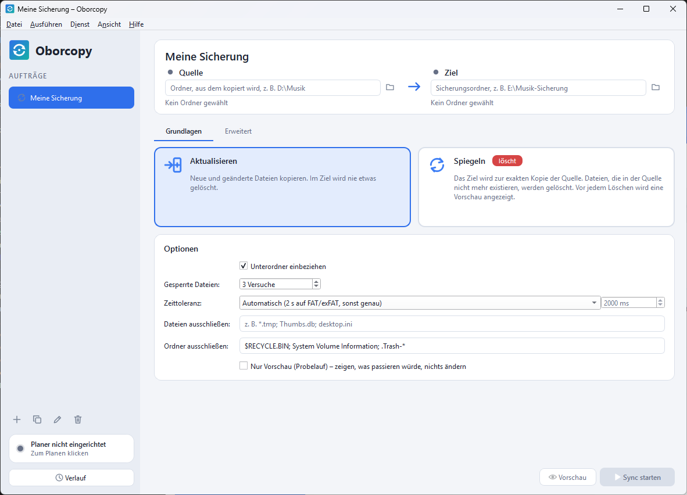

1. **Quelle:** Klicken Sie auf das Ordnersymbol neben *Quelle* und wählen Sie den Ordner, den Sie sichern möchten (z. B. Ihren Musikordner).
2. **Ziel:** Klicken Sie auf das Ordnersymbol neben *Ziel* und wählen Sie den Ordner auf Ihrer Sicherungsfestplatte. Er darf leer sein oder noch gar nicht existieren.
3. **Modus:** Klicken Sie auf die Karte **Aktualisieren** (löscht nie) oder **Spiegeln** (exakte Kopie).
4. **Vorschau:** Klicken Sie unten rechts auf **Vorschau**. Oborcopy zeigt, was es tun *würde* – es wird noch nichts geändert. Schließen Sie die Vorschau.
5. **Starten:** Klicken Sie auf **Sync starten**. Im Modus Spiegeln bestätigen Sie das Löschen noch einmal (siehe [Abschnitt 6.3](#63-eine-spiegelung-bestätigen)).
6. **Ergebnis:** Am Ende sehen Sie eine Zusammenfassung wie *„1.204 Dateien geprüft, 37 kopiert, 12 aktualisiert, 7 gelöscht, 0 Fehler“*. Klicken Sie auf **Details anzeigen** für die vollständige Liste.

Das war’s. Ihre Einstellungen werden automatisch gespeichert – nächste Woche klicken Sie einfach wieder auf **Sync starten**.

---

## 4. Das Hauptfenster

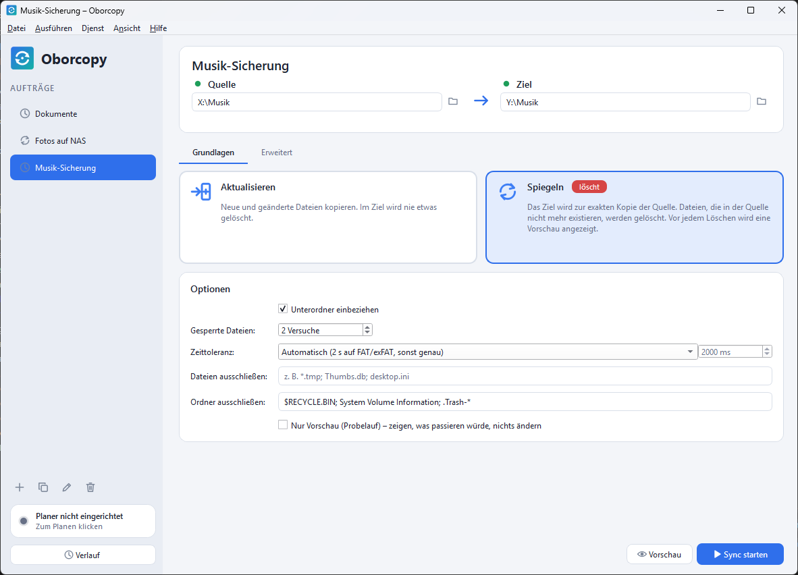

| Bereich | Was Sie dort finden |
|---|---|
| **Seitenleiste (links)** | Ihre Aufträge. Klicken Sie auf einen Auftrag, um ihn zu öffnen. Mit den Schaltflächen unter der Liste erstellen **(+)**, duplizieren, umbenennen und löschen Sie Aufträge. **Verlauf** zeigt frühere Läufe. |
| **Auftragskopf (oben)** | Name des Auftrags, **Quelle** und **Ziel**. Unter jedem Ordner zeigt Oborcopy Angaben zum Datenträger – Name, Dateisystem und freier Platz, z. B. *„BACKUP (E:) · exFAT · 412 GB frei von 1,8 TB · Zeitstempel in 2 s“*. Unter Linux wird die Datenträgerbezeichnung angezeigt (oder der Einhängepunkt, wenn der Datenträger keine Bezeichnung hat). Ist der Datenträger nicht angeschlossen, zeigt Oborcopy den zuletzt gesehenen Namen, z. B. *„Offline – BACKUP anschließen“*, damit Sie wissen, welchen Datenträger Sie anschließen müssen ([Abschnitt 4.2](#42-datenträger-und-laufwerksbuchstaben)). |
| **Reiter Grundlagen** | Die Modus-Karten **Aktualisieren** / **Spiegeln** und die wichtigsten Optionen. Mehr brauchen die meisten nie. |
| **Reiter Erweitert** | Alle weiteren Optionen, in Abschnitte gegliedert ([Abschnitt 8](#8-erweiterte-optionen)). |
| **Aktionsleiste (unten)** | **Vorschau** und **Sync starten**. Während eine Synchronisation läuft: **Pause/Fortsetzen** und **Abbrechen**. Links ein Statustext, z. B. *„Alle Änderungen gespeichert“*. |
| **Menüleiste** | *Datei* (neuer Auftrag, speichern, Verlauf, Protokollordner, beenden), *Ausführen* (starten, Vorschau, Pause, abbrechen), *Dienst* (Dienstverwaltung, Auftrag planen), *Ansicht* (Design, Sprache), *Hilfe* (Über Oborcopy). |

### 4.1 Ordner wählen

Es gibt drei Wege, einen Ordner anzugeben:

* auf das **Ordnersymbol** klicken und den Ordner auswählen,
* den Pfad ins Feld **tippen oder einfügen**, oder
* einen **Ordner** aus dem Explorer / Dateimanager **auf das Feld ziehen**.

Ein **Punkt** vor *Quelle* und *Ziel* zeigt, ob der Ordner gerade erreichbar ist. Oborcopy prüft das alle paar Sekunden. Der Punkt ändert sich also, sobald Sie einen Datenträger anschließen oder trennen oder ein Netzlaufwerk offline geht:

| Punkt | Bedeutung |
|---|---|
| 🟢 grün | **Online** – der Ordner ist erreichbar. Beim Ziel auch: *Ordner existiert noch nicht – er wird erstellt* (der übergeordnete Ordner existiert). |
| 🔴 rot | **Offline** – der Datenträger ist nicht angeschlossen, die Netzwerkfreigabe ist nicht erreichbar oder der Ordner wurde nicht gefunden. Ebenfalls rot: Wo früher der Datenträger des Auftrags war, ist **ein anderer Datenträger** angeschlossen ([Abschnitt 4.2](#42-datenträger-und-laufwerksbuchstaben)). |
| ⚪ grau | Noch kein Ordner gewählt, oder die Prüfung läuft noch. |

**Vorschau** und **Sync starten** (sowie `F5`/`F6`) sind nur verfügbar, solange beide Punkte grün sind. Die Zeile unten im Fenster sagt Ihnen, welcher Ordner fehlt.

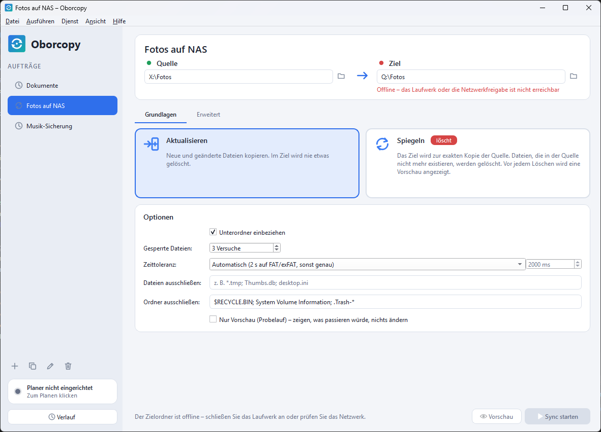

### 4.2 Datenträger und Laufwerksbuchstaben

Windows gibt einer USB-Festplatte nicht immer denselben Laufwerksbuchstaben – stecken Sie zuerst einen zweiten Stick ein, erscheint Ihre Sicherungsfestplatte vielleicht als **F:** statt **E:**. Oborcopy erkennt einen Datenträger deshalb an seiner **Bezeichnung** (dem Namen im Explorer, z. B. *BACKUP*) und nicht nur am Buchstaben. Es merkt sich die Bezeichnung, sobald der Ordner das erste Mal erreichbar ist.

| Was passiert | Was Oborcopy tut |
|---|---|
| Der Datenträger kommt mit **einem anderen Buchstaben** zurück | Der Ordner folgt dem Datenträger automatisch, z. B. wird `E:\Backup\Musik` zu `F:\Backup\Musik`. Die Statuszeile meldet *„Datenträger BACKUP ist jetzt unter F:\ – der Ordner wurde angepasst.“* Geplante Läufe tun dasselbe und vermerken es im Protokoll. |
| **Ein anderer Datenträger** hat den alten Buchstaben | Roter Punkt und *„ANDERER (E:) ist angeschlossen, nicht BACKUP“*. Vorschau und Sync starten bleiben gesperrt und geplante Läufe brechen mit einem Fehler ab – so kann eine Spiegelung nie den falschen Datenträger aufräumen. Wenn Sie diesen Datenträger künftig wirklich verwenden wollen, klicken Sie auf **ANDERER für den Auftrag verwenden**. |
| Der Datenträger ist **nicht angeschlossen** | *„Offline – BACKUP anschließen“*. |
| **Zwei angeschlossene Datenträger** haben dieselbe Bezeichnung | *„Mehrere angeschlossene Datenträger heißen BACKUP – trennen Sie alle bis auf einen“*. |
| Oborcopy **kennt den Datenträger noch nicht** (z. B. ein Auftrag aus einer älteren Version) und der Ordner fehlt | Gibt es denselben Ordner unter genau einem anderen Laufwerksbuchstaben, bietet Oborcopy ihn an: *„Offline – gefunden auf BACKUP (F:) · F:\Backup\Musik verwenden“*. Prüfen Sie, ob es der richtige Ordner ist, und klicken Sie dann auf den Link – ab dann ist der Datenträger bekannt und wird automatisch verfolgt. Geplante Läufe nennen den Ordner nur in ihrer Fehlermeldung; sie wechseln nie von selbst. |

Tipps:

* Geben Sie jeder Sicherungsfestplatte eine **eindeutige Bezeichnung** (im Explorer: Rechtsklick auf das Laufwerk → *Umbenennen*). Wechseln Sie für denselben Auftrag zwischen zwei Sicherungsfestplatten ab, geben Sie beiden **dieselbe** Bezeichnung – Oborcopy akzeptiert dann beide.
* Wählen Sie einen neuen Ordner (Ordnersymbol, Tippen, Ziehen und Ablegen), merkt sich Oborcopy den Datenträger des neuen Ordners.
* Datenträger ohne Bezeichnung werden wie bisher nur am Buchstaben erkannt.

### 4.3 Die Grundlagen-Optionen

| Option | Bedeutung | Empfehlung |
|---|---|---|
| **Unterordner einbeziehen** | Auch alles in Unterordnern kopieren. | Ein |
| **Gesperrte Dateien** | Wie oft eine Datei erneut versucht wird, die gerade von einem anderen Programm benutzt wird. Die Wartezeit wächst jedes Mal (2 s, 4 s, 8 s …). | 3 Versuche |
| **Zeittoleranz** | Wie genau die Dateizeiten übereinstimmen müssen, damit eine Datei als „unverändert“ gilt. *Automatisch* erlaubt 2 Sekunden auf FAT/exFAT-Datenträgern (USB-Sticks, viele externe Festplatten) – sonst sähe jede Datei geändert aus. | Automatisch |
| **Dateien ausschließen** | Dateien, die übersprungen werden, getrennt durch `;`. Platzhalter: `*` = beliebiger Text, `?` = ein Zeichen. Beispiel: `*.tmp; Thumbs.db; desktop.ini` | nach Bedarf |
| **Ordner ausschließen** | Ordner, die übersprungen werden. Windows-Systemordner sind bereits ausgeschlossen. | Vorgaben lassen |
| **Nur Vorschau (Probelauf)** | Jeder Lauf zeigt nur, was passieren würde – es wird nichts geändert. | Aus |

> **Gut zu wissen:** Ausgeschlossene Dateien werden weder kopiert noch gelöscht – auch nicht im Modus Spiegeln.

---

## 5. Aufträge verwalten

Ein **Auftrag** speichert alles zu einer Sicherungsaufgabe. Legen Sie pro Aufgabe einen Auftrag an, z. B. *Musik-Sicherung*, *Fotos auf NAS*, *Dokumente*.

| Aktion | So geht’s |
|---|---|
| **Auftrag erstellen** | Klicken Sie unter der Auftragsliste auf **+** (oder *Datei → Neuer Auftrag…*, `Strg+N`) und geben Sie einen Namen ein. |
| **Auftrag öffnen** | Klicken Sie ihn in der Liste an. |
| **Umbenennen** | Doppelklicken Sie auf den Auftrag oder klicken Sie auf den Stift. |
| **Duplizieren** | Wählen Sie den Auftrag und klicken Sie auf die Schaltfläche Duplizieren – praktisch für eine zweite Sicherungsfestplatte mit denselben Einstellungen. |
| **Löschen** | Klicken Sie auf den Papierkorb. Nur die Einstellungen des Auftrags werden entfernt – **Dateien bleiben unberührt**. |
| **Speichern** | Nicht nötig: Jede Änderung wird innerhalb einer Sekunde automatisch gespeichert. |

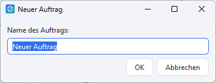

---

## 6. Schritt für Schritt: eine Synchronisation ausführen

Das folgende Beispiel verwendet den Auftrag **Musik-Sicherung** im Modus **Spiegeln**: Die Musiksammlung auf `X:\Musik` wird auf die Sicherungsfestplatte `Y:\Musik` gespiegelt. Seit der letzten Sicherung sind zwei Alben dazugekommen, ein Titel wurde neu eingelesen und ein Album wurde entfernt.

### 6.1 Vorschau – sehen, was passieren wird

Klicken Sie auf **Vorschau** (oder drücken Sie `F6`). Oborcopy liest beide Ordner ein und vergleicht sie. **Es wird nichts geändert.**


Oben sehen Sie die Zahlen: geprüfte Dateien, **neue** Dateien, Dateien **zu aktualisieren**, Dateien **zu löschen** und wie viele Daten kopiert werden.

Darunter steht ein **Ordnerbaum** mit jeder geplanten Aktion:

* <span style="color:#1E9E5A">●</span> **Neu** – die Datei gibt es im Ziel noch nicht.
* <span style="color:#2F6FEB">●</span> **Aktualisieren** – die Datei gibt es, aber sie ist anders (neuer, älter oder andere Größe).
* <span style="color:#D64545">●</span> **Löschen** – die Datei gibt es nur im Ziel (nur im Modus Spiegeln).

Die farbigen Schaltflächen über dem Baum (*Neu 19*, *Aktualisieren 1*, *Löschen 9* …) sind **Filter**: Ein Klick blendet diese Art von Einträgen aus oder ein. Mit **Suchen…** finden Sie eine Datei, mit **Aufklappen / Zuklappen** öffnen oder schließen Sie die Ordner. In der Spalte *Details* steht, warum etwas passiert, z. B. *neue Datei*, *Quelle neuer* oder *nicht in der Quelle*.

Sieht alles richtig aus, können Sie direkt in der Vorschau auf **Sync starten** klicken – oder auf **Abbrechen**, um ohne Änderungen zurückzukehren.

> **Tipp:** Meldet die Vorschau *„Alles ist aktuell“*, gibt es nichts zu tun.

### 6.2 Die Synchronisation starten

Klicken Sie auf **Sync starten** (oder drücken Sie `F5`).

* Im Modus **Aktualisieren** oder wenn nichts gelöscht werden muss, beginnt die Synchronisation sofort.
* Im Modus **Spiegeln** mit Löschungen zeigt Oborcopy zuerst das Bestätigungsfenster.

### 6.3 Eine Spiegelung bestätigen

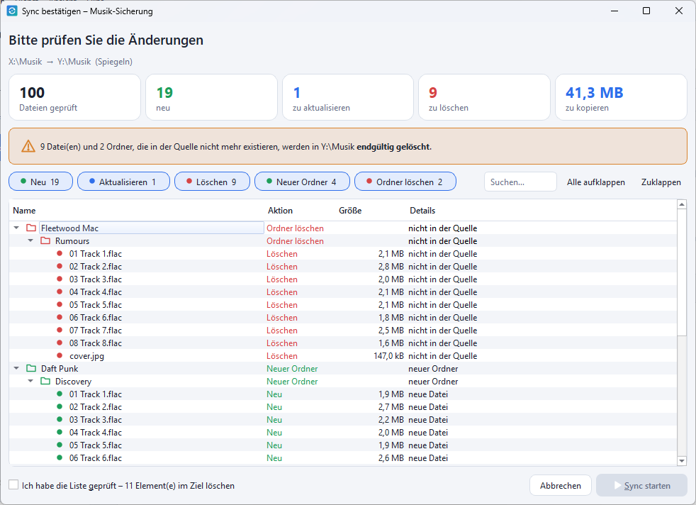

Dieses Fenster sieht aus wie die Vorschau. Der orange Kasten sagt Ihnen, **wie viele Dateien und Ordner gelöscht werden** und **wo**. Die Schaltfläche **Sync starten** bleibt grau, bis Sie unten das Kästchen ankreuzen:

**☑ Ich habe die Liste geprüft – 11 Element(e) im Ziel löschen**

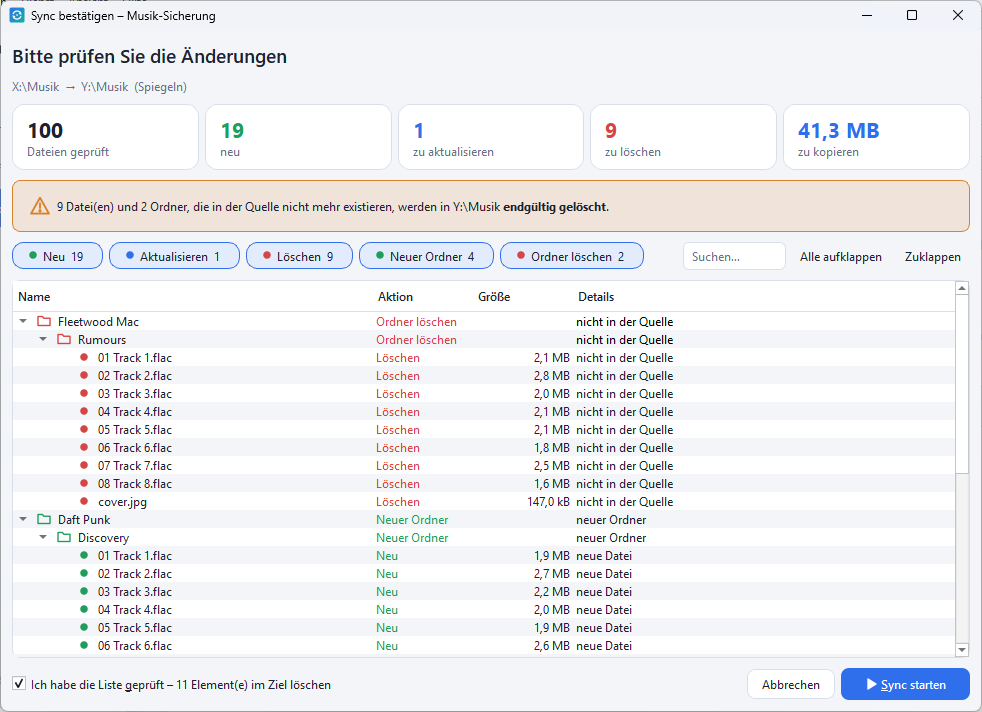

Klicken Sie dann auf **Sync starten**.

> **Rote Warnung?** Würde ein großer Teil der Sicherung gelöscht (standardmäßig mehr als 20 %), zeigt Oborcopy zusätzlich eine **rote Warnung**. Das bedeutet meist, dass der **falsche Quellordner** gewählt wurde oder der **Quelldatenträger nicht angeschlossen** ist. Klicken Sie auf **Abbrechen** und prüfen Sie zuerst die Quelle.

### 6.4 Den Fortschritt verfolgen

Während die Synchronisation läuft, ersetzt die Fortschrittsanzeige die Optionen:

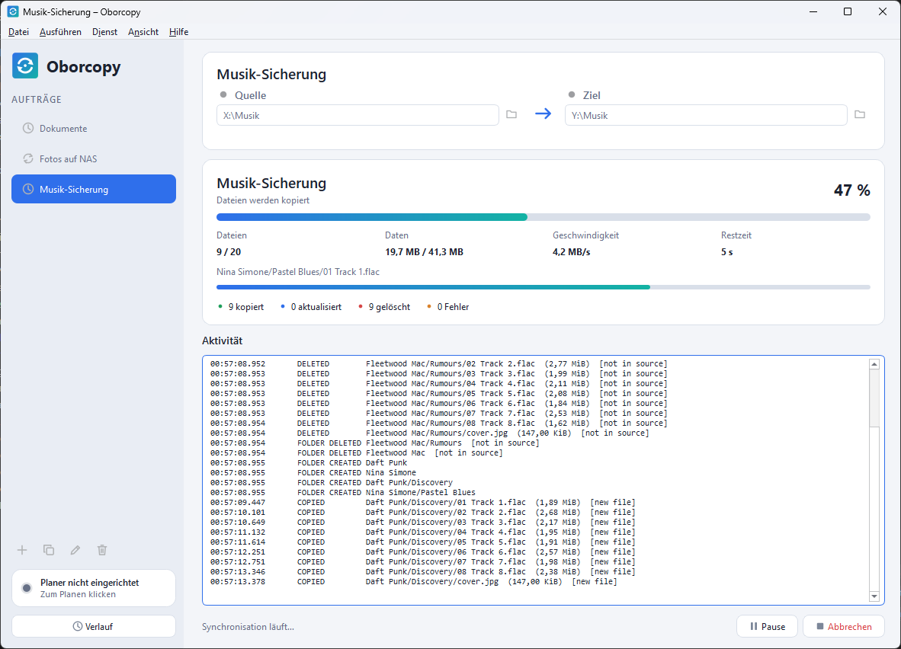

* **Prozentzahl und Balken** – Gesamtfortschritt (nach Datenmenge).
* **Dateien** – bisher kopierte Dateien / zu kopierende Dateien.
* **Daten**, **Geschwindigkeit**, **Restzeit** – kopierte Menge, aktuelle Geschwindigkeit und geschätzte Restzeit.
* **Aktuelle Datei** mit eigenem kleinem Fortschrittsbalken.
* **Zähler** – bisher kopiert, aktualisiert, gelöscht, Fehler.
* **Aktivität** – eine laufende Liste von allem, was Oborcopy tut. Sie entspricht der Protokolldatei und ist deshalb immer auf Englisch ([Abschnitt 11.2](#112-sprache)).

Sie können den Computer weiter benutzen – Oborcopy bleibt die ganze Zeit bedienbar.

### 6.5 Pausieren, fortsetzen oder abbrechen

* **Pause** (`F7`) – hält das Kopieren nach dem aktuellen Datenblock an; die Schaltfläche wechselt zu **Fortsetzen**. Praktisch, wenn Sie kurz die volle Geschwindigkeit des Datenträgers für etwas anderes brauchen.
* **Abbrechen** (`Umschalt+F5`) – beendet die Synchronisation. Bereits kopierte Dateien bleiben im Ziel; die Datei, die gerade kopiert wurde, wird verworfen. So gibt es in Ihrer Sicherung **nie halb kopierte Dateien**. Starten Sie die Synchronisation später einfach erneut – Oborcopy macht dort weiter, wo es aufgehört hat.

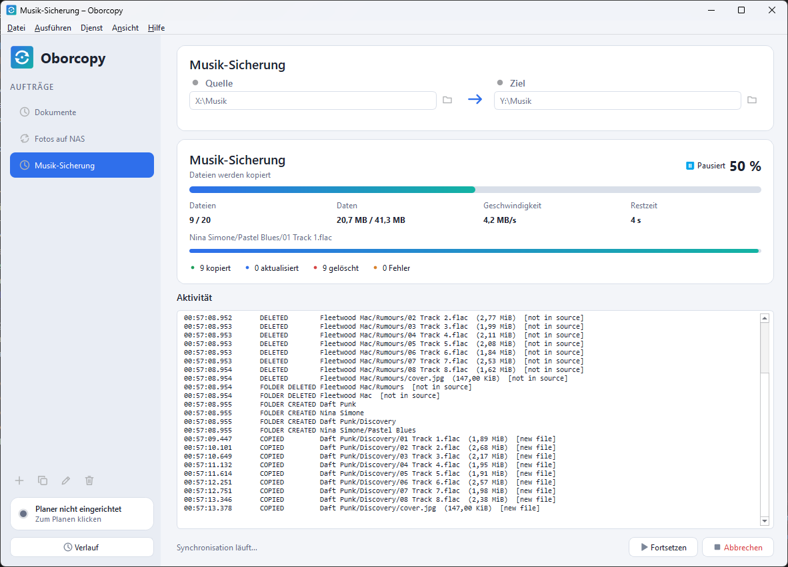

### 6.6 Das Ergebnis

Ist die Synchronisation fertig, erscheint oben eine Ergebniszeile:

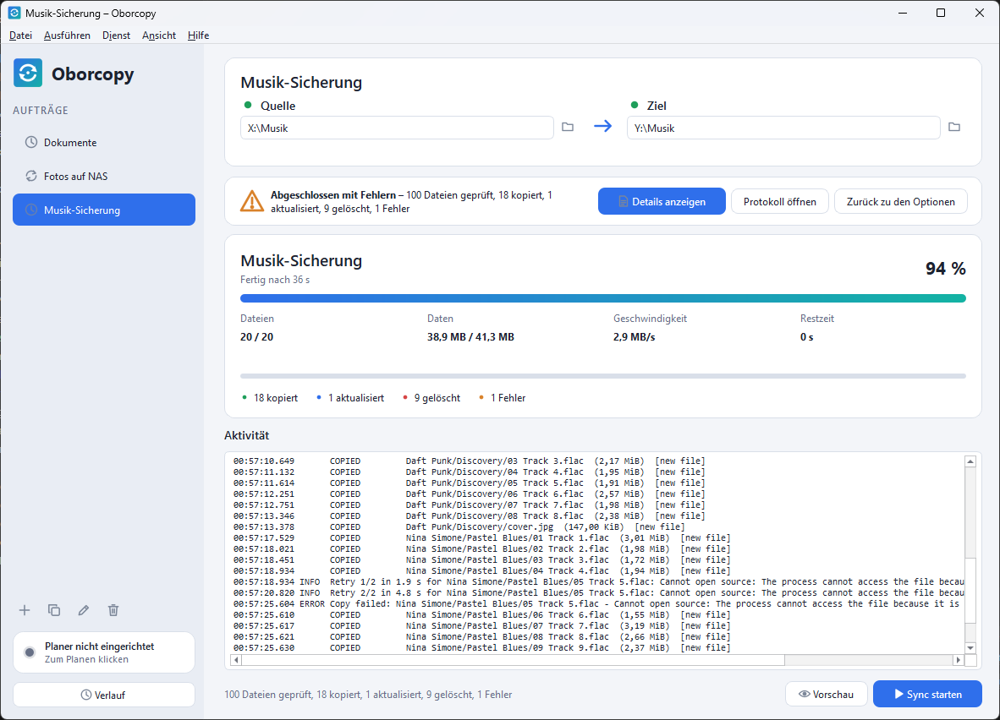

| Symbol | Bedeutung |
|---|---|
| Grüner Haken ✔ | **Abgeschlossen** – alles hat geklappt. |
| Oranges Dreieck ⚠ | **Abgeschlossen mit Fehlern** – die meisten Dateien wurden kopiert, einige nicht (siehe [Abschnitt 7.2](#72-fehler-verstehen)). |
| Graues Quadrat ■ | **Abgebrochen** – Sie haben die Synchronisation beendet. |
| Rotes Kreuz ✖ | **Fehlgeschlagen** – die Synchronisation konnte nicht laufen (z. B. weil der Quellordner nicht existiert). Der Grund wird angezeigt. |

Schaltflächen:

* **Details anzeigen** – öffnet die ausführliche Zusammenfassung ([Abschnitt 7](#7-die-ergebnisse-lesen)).
* **Protokoll öffnen** – öffnet die Protokolldatei dieses Laufs in einem Texteditor.
* **Zurück zu den Optionen** – zurück zu den Einstellungen des Auftrags.

---

## 7. Die Ergebnisse lesen

### 7.1 Die ausführliche Zusammenfassung

Klicken Sie nach einer Synchronisation auf **Details anzeigen** oder öffnen Sie einen früheren Lauf aus dem **Verlauf**.

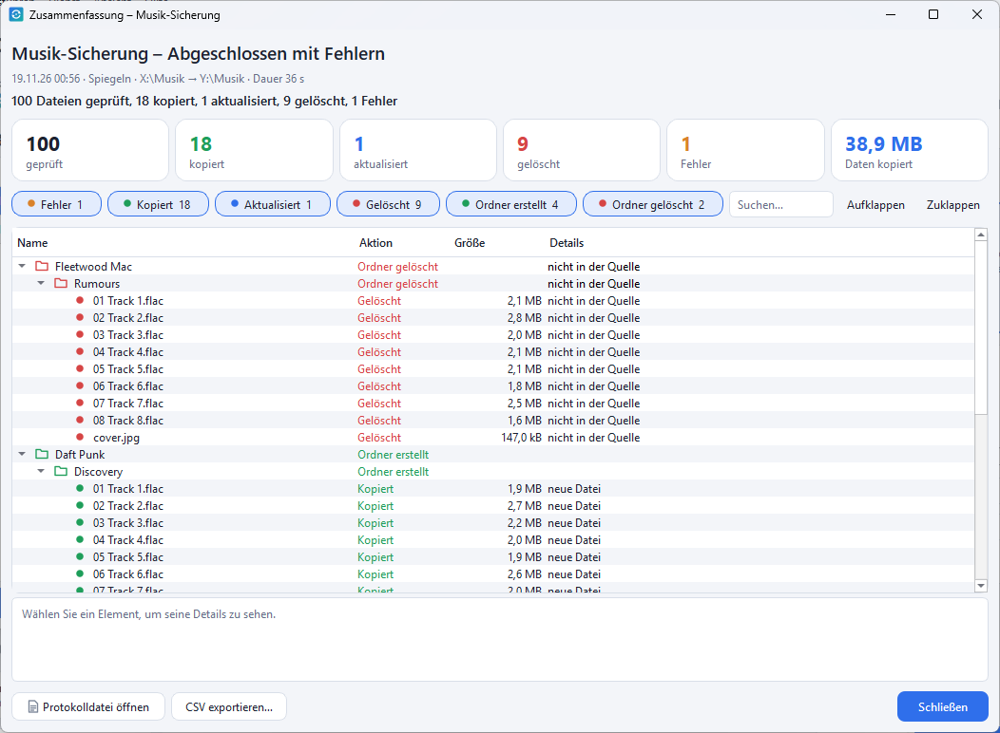

* **Oben:** Name des Auftrags und Ergebnis, Datum, Modus, Ordner und Dauer, darunter die Zusammenfassung, z. B. *„100 Dateien geprüft, 18 kopiert, 1 aktualisiert, 9 gelöscht, 1 Fehler“*.
* **Kacheln:** geprüft, kopiert, aktualisiert, gelöscht, Fehler und kopierte Datenmenge.
* **Filter-Schaltflächen:** *Fehler*, *Kopiert*, *Aktualisiert*, *Gelöscht*, *Ordner erstellt*, *Ordner gelöscht* – ein Klick blendet die jeweilige Gruppe ein oder aus.
* **Ordnerbaum:** jede kopierte, aktualisierte oder gelöschte Datei in ihrem Ordner.
* **Detailbereich (unten):** Klicken Sie auf einen Eintrag, um den vollständigen Quell- und Zielpfad, die Größe und den Grund zu sehen.
* **Protokolldatei öffnen** / **CSV exportieren…** – die CSV-Datei öffnet sich in Excel oder LibreOffice Calc. Ihre Spalten und Werte sind wie das Protokoll auf Englisch.

### 7.2 Fehler verstehen

Ein Fehler bedeutet, dass eine Datei nicht verarbeitet werden konnte – **alle anderen Dateien wurden trotzdem synchronisiert**. Um nur die Fehler zu sehen, schalten Sie alle Filter-Schaltflächen außer **Fehler** aus und klicken dann auf die Datei:

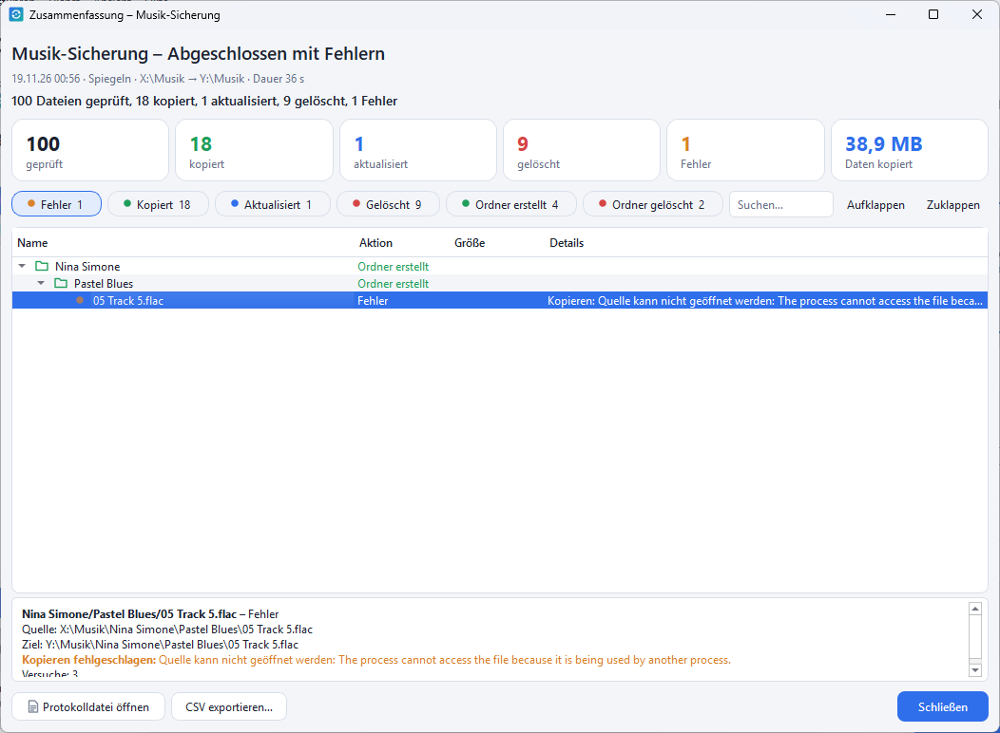

Die Details zeigen, was versucht wurde, die Meldung des Betriebssystems und wie viele Versuche gemacht wurden. In diesem Beispiel war die Datei **in einem anderen Programm geöffnet**; Oborcopy hat es 3-mal versucht und dann weitergemacht. Der Teil nach dem letzten Doppelpunkt stammt vom Betriebssystem und erscheint in dessen Sprache – auf einem deutschen Windows *„Der Prozess kann nicht auf die Datei zugreifen, da sie von einem anderen Prozess verwendet wird“*, auf einem englischen *„The process cannot access the file because it is being used by another process“*.

**Was tun:** Schließen Sie das Programm, das die Datei benutzt (oder warten Sie, bis es fertig ist), und starten Sie die Synchronisation einfach erneut. Nur die fehlende Datei wird dann kopiert.

Häufige Meldungen:

| Meldung | Ursache | Lösung |
|---|---|---|
| *…von einem anderen Prozess verwendet…* / *being used by another process* | Die Datei ist in einem anderen Programm geöffnet. | Programm schließen, erneut starten. Kommt es oft vor, erhöhen Sie die Versuche bei *Gesperrte Dateien*. |
| *Zugriff verweigert* / *Access is denied* / *Permission denied* | Keine Berechtigung, die Quelle zu lesen oder ins Ziel zu schreiben. | Ordnerberechtigungen prüfen; unter Windows ist die Datei vielleicht schreibgeschützt oder liegt an einem geschützten Ort. |
| *Die Quelldatei existiert nicht mehr* | Die Datei wurde während der Synchronisation gelöscht oder verschoben. | Nichts zu tun. |
| *Nicht genügend Speicherplatz* / *No space left on device* | Der Zieldatenträger ist voll. | Platz schaffen oder einen größeren Datenträger verwenden. Die Vorschau warnt vorher davor. |

### 7.3 Verlauf

Klicken Sie in der Seitenleiste auf **Verlauf** (oder *Datei → Verlauf…*, `Strg+H`), um alle früheren Läufe aller Aufträge zu sehen:

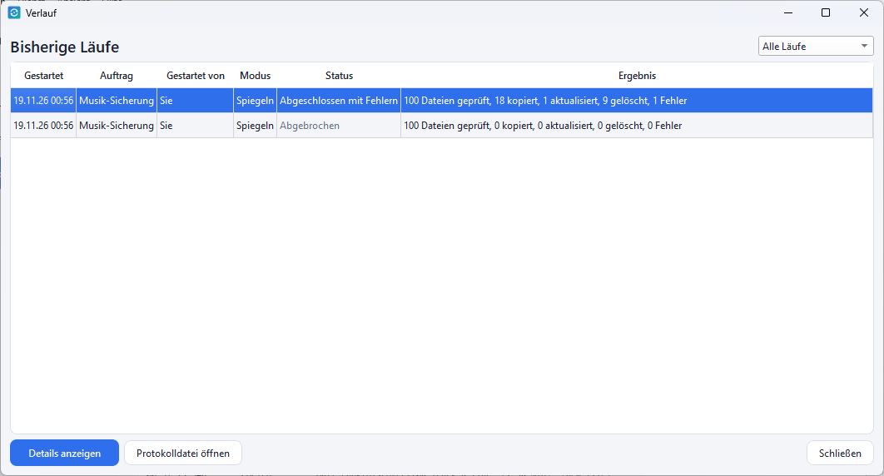

Wählen Sie einen Lauf und klicken Sie auf **Details anzeigen** (oder doppelklicken Sie), um seine Zusammenfassung zu öffnen, oder auf **Protokolldatei öffnen**, um sein Protokoll zu lesen. Auch eine abgebrochene Vorschau erscheint hier, als *Abgebrochen*.

---

## 8. Erweiterte Optionen

Der Reiter **Erweitert** enthält die übrigen Optionen in Abschnitten. Ein Klick auf einen Abschnittstitel öffnet oder schließt ihn. Die Vorgaben sind so gewählt, dass Sie hier normalerweise nichts ändern müssen.

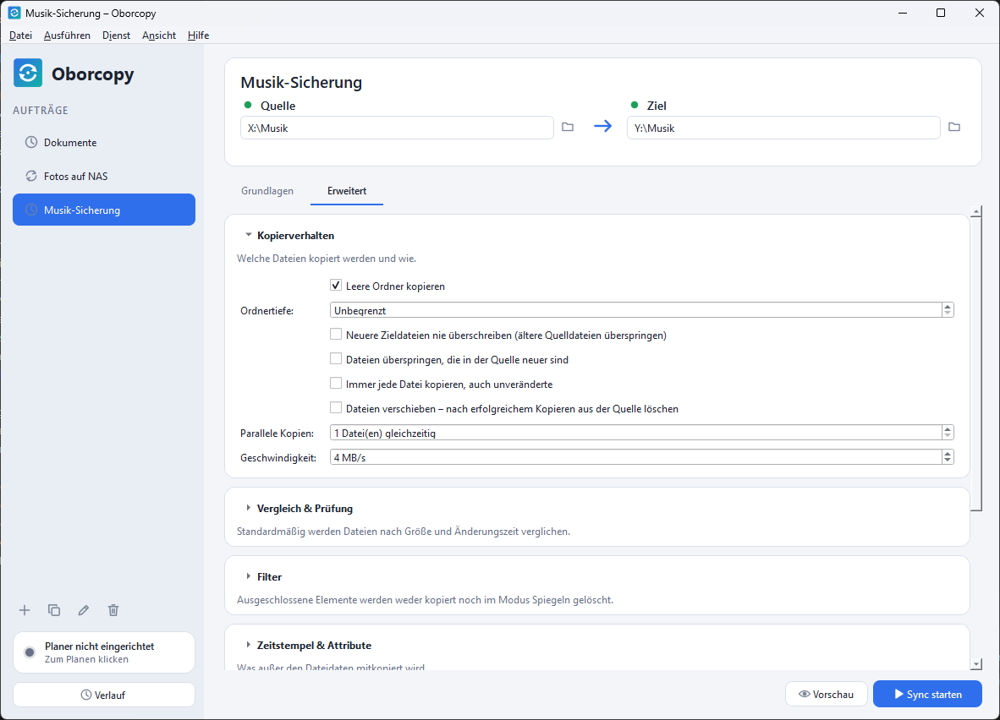

### 8.1 Kopierverhalten

| Option | Bedeutung |
|---|---|
| **Leere Ordner kopieren** | Auch Ordner anlegen, die keine Dateien enthalten. |
| **Ordnertiefe** | *Unbegrenzt* oder nur die ersten *n* Ordnerebenen (1 = nur die Dateien direkt im Quellordner). |
| **Neuere Zieldateien nie überschreiben** | Ist die Datei im Ziel neuer als in der Quelle, bleibt sie erhalten. |
| **Dateien überspringen, die in der Quelle neuer sind** | Nur neue Dateien und Dateien kopieren, die älter geworden sind (selten nötig). |
| **Immer jede Datei kopieren** | Alles kopieren, auch unveränderte Dateien (langsam – für Sonderfälle). |
| **Dateien verschieben** | Jede Datei nach erfolgreichem Kopieren aus der **Quelle** löschen. ⚠ Mit Vorsicht verwenden. |
| **Parallele Kopien** | Mehrere Dateien gleichzeitig kopieren. Hilft bei SSDs und Netzlaufwerken; für normale Festplatten ist 1 meist am schnellsten. |
| **Geschwindigkeit** | Die Kopiergeschwindigkeit in MB/s begrenzen, z. B. damit ein Netzwerk benutzbar bleibt. *Unbegrenzt* = volle Geschwindigkeit. (Im Bild ist eine Grenze von 4 MB/s eingestellt.) |

### 8.2 Vergleich & Prüfung

| Option | Bedeutung |
|---|---|
| **Genau 1 Stunde Unterschied ignorieren** | Verhindert, dass nach der Umstellung auf oder von der Sommerzeit auf FAT-Datenträgern alles neu kopiert wird. Schalten Sie es ein, wenn zweimal im Jahr alle Dateien „aktualisiert“ werden. |
| **Dateiinhalte vergleichen (SHA-256)** | Vergleicht auch den tatsächlichen Inhalt von Dateien, die unverändert aussehen. Findet stille Änderungen, liest aber jede Datei – viel langsamer. |
| **Jede kopierte Datei prüfen** | Nach dem Kopieren wird die Kopie erneut gelesen und mit dem Original verglichen. Empfohlen für sehr wertvolle Daten; dauert etwa doppelt so lange. |

### 8.3 Filter

| Option | Bedeutung |
|---|---|
| **Nur Dateien** | Nur passende Dateien kopieren, z. B. `*.mp3; *.flac`. Leer = alle Dateien. |
| **Mindestgröße / Höchstgröße** | Dateien überspringen, die kleiner / größer als die angegebene Größe (MB) sind. |
| **Dateien überspringen, neuer / älter als** | Dateien nach Alter in Tagen überspringen. |
| **Versteckte Dateien / Systemdateien überspringen** | Versteckte Dateien und Ordner oder Windows-Systemdateien überspringen. |
| **Links** | Symbolische Links und Verzeichnisverbindungen überspringen (Vorgabe) oder ihnen folgen und ihr Ziel kopieren. |

### 8.4 Zeitstempel & Attribute

Lassen Sie **Änderungszeiten der Dateien beibehalten** eingeschaltet – Oborcopy braucht sie, um unveränderte Dateien beim nächsten Mal zu erkennen. Ordnerzeiten, Windows-Attribute (schreibgeschützt, versteckt …) und Linux-Berechtigungen können ebenfalls übernommen werden.

### 8.5 Wiederholungen

**Erste Wartezeit** (Vorgabe 2 s) und **Längste Wartezeit** (Vorgabe 60 s) für gesperrte Dateien. Die Wartezeit verdoppelt sich mit jedem Versuch. Die Anzahl Versuche wird im Reiter Grundlagen eingestellt.

### 8.6 Schutz beim Spiegeln

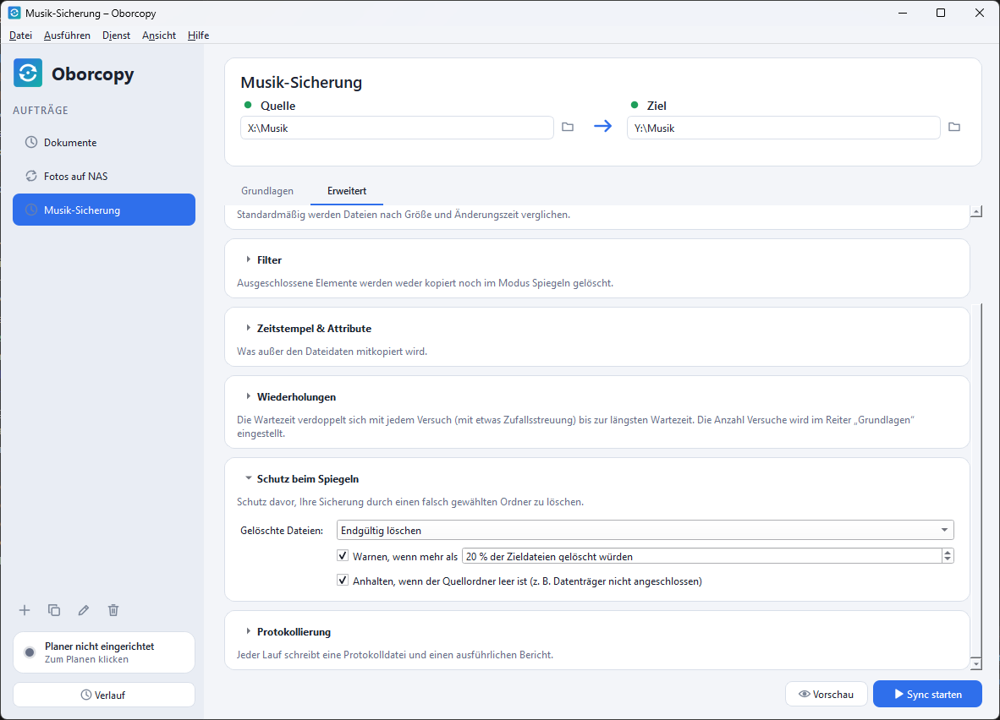

| Option | Bedeutung |
|---|---|
| **Gelöschte Dateien** | *Endgültig löschen* (Vorgabe) oder *In den Archivordner verschieben*: Gelöschte Dateien werden in den Ordner **`.oborcopy-archive`** im Ziel verschoben (nach Datum und Uhrzeit sortiert), statt gelöscht zu werden. Von dort können Sie sie wiederherstellen oder das Archiv später selbst löschen. |
| **Warnen, wenn mehr als … % der Zieldateien gelöscht würden** | Zeigt im Bestätigungsfenster eine rote Warnung (und stoppt automatische Läufe über die Kommandozeile), wenn viele Dateien gelöscht würden. Vorgabe 20 %. |
| **Anhalten, wenn der Quellordner leer ist** | Verhindert, dass Ihre Sicherung gelöscht wird, wenn der Quelldatenträger nicht angeschlossen ist. Lassen Sie es eingeschaltet. |

### 8.7 Protokollierung

| Option | Bedeutung |
|---|---|
| **Protokollordner** | Wo die Protokolldateien gespeichert werden. Leer = Standardort ([Abschnitt 11](#11-einstellungen-protokolle-und-speicherorte)). |
| **Detailgrad** | *Nur Zusammenfassung*, *Änderungen* (jede kopierte/aktualisierte/gelöschte Datei – empfohlen) oder *Alle Dateien* (auch unveränderte – große Protokolle). |
| **Protokolle behalten der letzten** | Ältere Protokolle dieses Auftrags werden automatisch gelöscht (Vorgabe: 50 Läufe). |

---

## 9. Wöchentliche Sicherung – die empfohlene Routine

Für eine Musiksammlung (oder Fotos, Dokumente …) mit einer Sicherungsfestplatte:

**Einmal – den Auftrag einrichten**

1. Legen Sie einen Auftrag an, z. B. *Musik-Sicherung*.
2. Quelle = Ihr Musikordner, Ziel = ein Ordner auf der Sicherungsfestplatte.
3. Wählen Sie **Spiegeln**.
4. *Optional:* Erweitert → Schutz beim Spiegeln → **In den Archivordner verschieben** für zusätzliche Sicherheit.

**Jede Woche**

1. Schließen Sie die Sicherungsfestplatte an.
2. Starten Sie Oborcopy und wählen Sie den Auftrag.
3. Klicken Sie auf **Sync starten**.
4. Werden Dateien gelöscht, sehen Sie sich die Liste im Bestätigungsfenster an. Sind das wirklich Dateien, die Sie absichtlich entfernt haben? Dann kreuzen Sie das Kästchen an und klicken auf **Sync starten**.
5. Prüfen Sie die Ergebniszeile. Zeigt sie Fehler, öffnen Sie **Details anzeigen**.
6. Werfen Sie die Sicherungsfestplatte sicher aus.

> **Tipp:** Bewahren Sie eine zweite Sicherungsfestplatte an einem anderen Ort auf (z. B. bei der Arbeit oder in der Familie) und legen Sie dafür mit **Duplizieren** einen zweiten Auftrag an.

---

## 10. Automatische Sicherungen

Oborcopy kann Ihre Aufträge automatisch zu festen Zeiten ausführen – alle paar Stunden, täglich, wöchentlich oder monatlich. Am einfachsten geht das mit dem eingebauten Dienst **Oborcopy Scheduler** (10.1 – 10.5). Wenn Sie möchten, können Sie auch das Kommandozeilenwerkzeug mit der Windows-Aufgabenplanung oder cron verwenden (10.6 – 10.8).

### 10.1 Der Dienst Oborcopy Scheduler

Der Oborcopy Scheduler ist ein kleines Hintergrundprogramm, das als echter Dienst Ihres Betriebssystems installiert wird:

* **Windows:** Er erscheint unter *Dienste* (`services.msc`) als **Oborcopy Scheduler** und startet automatisch mit Windows.
* **Linux:** Er ist ein *systemd-Benutzerdienst* (`oborcopy.service`) Ihres Kontos. Prüfen Sie ihn mit `systemctl --user status oborcopy`.

Der Dienst läuft **unter Ihrem eigenen Benutzerkonto**. Deshalb sieht er dieselben Aufträge, dieselben Ordner und dieselben Netzwerkfreigaben (z. B. `\\nas\backup`) wie Oborcopy selbst. Sie können **Oborcopy schließen** – der Dienst läuft weiter und startet Ihre Aufträge pünktlich. Oborcopy ist nur die *Dienstverwaltung*: Damit richten Sie den Dienst ein, steuern und überprüfen ihn.

Der Dienst führt jeweils einen Auftrag mit `oborcopy-cli` aus und schreibt die normale Protokolldatei und den Bericht – jeder automatische Lauf erscheint also im **Verlauf**.

### 10.2 Den Dienst installieren

1. Öffnen Sie *Dienst → Dienstverwaltung…* (`Strg+M`) oder klicken Sie in der Seitenleiste über *Verlauf* auf die **Statusanzeige**. Solange der Dienst nicht installiert ist, steht dort *Planer nicht eingerichtet*.
2. Klicken Sie auf **Dienst installieren…**.
3. **Windows:** Bestätigen Sie die Administratorabfrage (Benutzerkontensteuerung). Danach fragt Windows nach **Ihrem Windows-Kennwort** – der Dienst braucht es, um sich als Sie anzumelden. Verwenden Sie Ihr Kennwort, nicht eine Windows-Hello-PIN. Oborcopy sieht und speichert das Kennwort nie; Windows verwahrt es.
   **Linux:** Es gibt nichts zu bestätigen – kein root-Kennwort nötig. Oborcopy schaltet auch *linger* ein, damit der Dienst nach dem Abmelden weiterläuft und beim Hochfahren startet. Erlaubt Ihr System das nicht, zeigt Oborcopy einen Hinweis; der Dienst läuft dann, solange Sie angemeldet sind.
4. Der Status wechselt zu **Dienst läuft**.

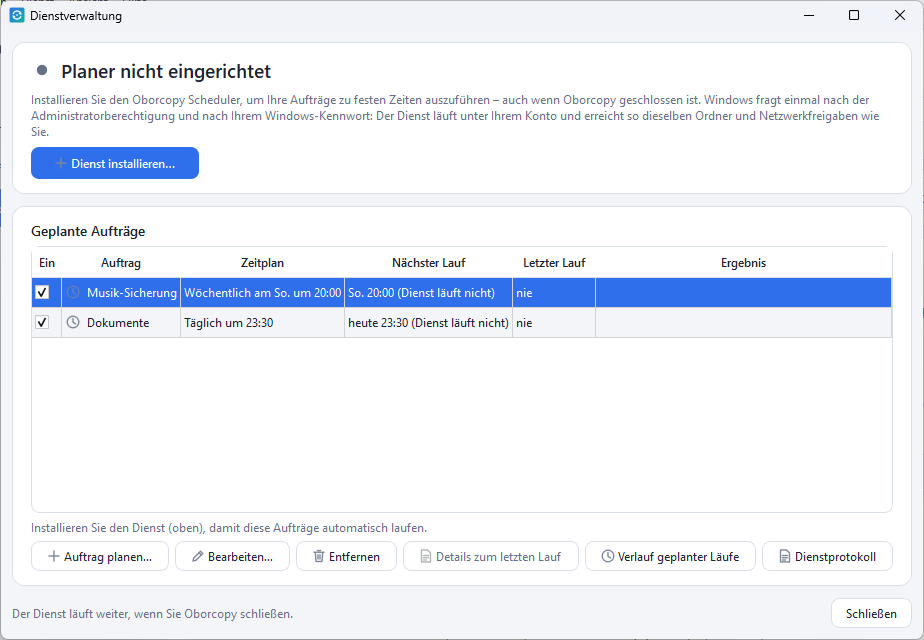

Das Bild zeigt die Dienstverwaltung **vor** der Installation: Die beiden Zeitpläne sind schon eingetragen, laufen aber erst, wenn der Dienst installiert ist (*„Dienst läuft nicht“* in der Spalte *Nächster Lauf*). Nach der Installation zeigt der obere Bereich *Dienst läuft* mit den Schaltflächen **Starten**, **Pause**, **Stoppen**, **Neu starten**, **Kennwort aktualisieren…** und **Deinstallieren**.

> **Tipp:** Ändern Sie später Ihr Windows-Kennwort, kann sich der Dienst nicht mehr anmelden. Die Dienstverwaltung zeigt dann einen Fehler – klicken Sie auf **Kennwort aktualisieren…**.

### 10.3 Einen Auftrag planen

1. Klicken Sie in der Dienstverwaltung auf **Auftrag planen…** – oder wählen Sie im Hauptfenster einen Auftrag und dann *Dienst → Diesen Auftrag planen…*.
2. Wählen Sie den **Auftrag** und wie oft er laufen soll:
   * **Alle paar Stunden** – z. B. alle 4 Stunden zur Minute :15 (00:15, 04:15, 08:15 …)
   * **Täglich** – zu einer Uhrzeit, z. B. 23:30
   * **Wöchentlich** – an den angeklickten Tagen, z. B. Mo. und Do. um 07:00
   * **Monatlich** – an einem Tag des Monats oder am **letzten Tag**. Ein Tag, den der Monat nicht hat (z. B. der 31.), läuft an seinem letzten Tag.
3. Optionen:
   * **Eine verpasste Sicherung nach dem Start einmal nachholen** – war der Computer zur geplanten Zeit aus, läuft der Auftrag einmal, sobald der Dienst wieder startet.
   * **Löschen im Modus Spiegeln erlauben** – nötig für unbeaufsichtigte Spiegel-Aufträge. Die Löschgrenze aus *Schutz beim Spiegeln* (8.6) gilt weiterhin: Würden zu viele Dateien gelöscht, wird der Lauf stattdessen angehalten.
   * **Wiederholen, wenn der Lauf fehlschlägt** – praktisch, wenn die Sicherungsfestplatte oder das NAS manchmal noch nicht erreichbar ist, z. B. direkt nach dem Hochfahren. Wählen Sie, wie oft und in welchem Abstand, z. B. *bis zu 8 Mal, alle 15 Minuten* (= insgesamt bis zu 2 Stunden). Wiederholt werden nur **fehlgeschlagene** Läufe (Ordner oder Datenträger nicht erreichbar); ein Lauf, der mit einigen Fehlern abgeschlossen oder von der Löschgrenze angehalten wurde, nicht. Die Dienstverwaltung zeigt eine anstehende Wiederholung unter *Nächster Lauf*, z. B. *08:15 (Wiederholung 2 von 8)*.
4. Die Vorschau unten zeigt die nächsten Laufzeiten. Klicken Sie auf **Zeitplan speichern**.

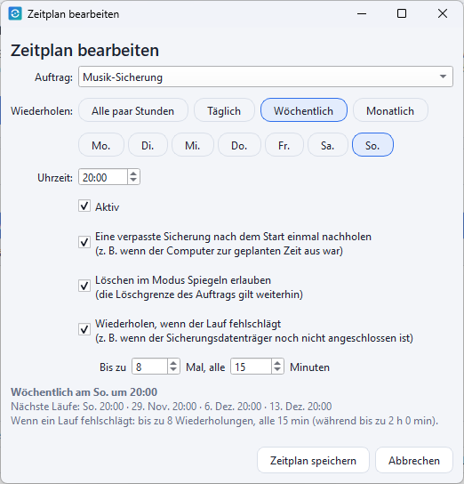

Geplante Aufträge haben in der Auftragsliste ein **Uhrsymbol**. Der laufende Dienst übernimmt Änderungen innerhalb weniger Sekunden. Entfernen Sie in der Liste das Häkchen bei **Ein**, um einen Zeitplan auszuschalten, ohne ihn zu löschen.

### 10.4 Den Dienst steuern

| Schaltfläche | Was sie tut |
|---|---|
| **Starten** | Startet den gestoppten Dienst. |
| **Pause / Fortsetzen** | Solange pausiert ist, startet kein geplanter Auftrag. Ein bereits laufender Auftrag wird beendet. |
| **Stoppen** | Stoppt den Dienst. Ein laufender Auftrag wird sauber abgebrochen (er erscheint im Verlauf als *Abgebrochen*). |
| **Neu starten** | Stoppen + Starten. |
| **Deinstallieren** | Entfernt den Dienst. Ihr Zeitplan bleibt für eine spätere Installation erhalten. |

Die **Statusanzeige** in der Seitenleiste zeigt immer, was der Dienst gerade tut:

| Anzeige | Bedeutung |
|---|---|
| 🟢 **Dienst läuft** · *Nächster: Musik-Sicherung · heute 23:30* | Wartet auf den nächsten Auftrag (der Punkt pulsiert sanft). |
| 🔵 **Sicherung läuft: Musik-Sicherung** | Gerade läuft ein geplanter Auftrag (schnelleres Pulsieren). |
| 🟠 **Dienst pausiert** | Kein Auftrag startet, bis Sie fortsetzen. |
| ⚪ **Dienst gestoppt** / **Planer nicht eingerichtet** | Geplante Aufträge laufen nicht. |
| 🔴 **Dienstfehler** | Klicken Sie darauf, um den Grund zu sehen, z. B. ein geändertes Windows-Kennwort. |

Verschieben Sie den Oborcopy-Ordner oder entpacken Sie eine neue Version an einem anderen Ort, meldet die Dienstverwaltung, dass der Dienst noch den alten Ordner verwendet – klicken Sie auf **Dieses Oborcopy verwenden**.

> **Bevor Sie den Oborcopy-Ordner löschen,** deinstallieren Sie den Dienst in der Dienstverwaltung.

### 10.5 Geplante Läufe überprüfen

* Die Dienstverwaltung listet jeden geplanten Auftrag mit **nächstem Lauf**, **letztem Lauf** und **Ergebnis**. **Details zum letzten Lauf** öffnet die ausführliche Zusammenfassung des letzten Laufs.
* **Verlauf geplanter Läufe** öffnet den Verlauf, gefiltert auf die vom Planer gestarteten Läufe. Dort können Sie wie gewohnt **Details anzeigen** und **Protokolldatei öffnen** verwenden. Im normalen Verlauf zeigt die Spalte *Gestartet von* entweder **Planer** oder **Sie**.
* **Dienstprotokoll** öffnet das eigene Protokoll des Dienstes (Start, Stopp, Änderungen am Zeitplan, jeder Lauf).
* Starten Sie in Oborcopy einen Auftrag, den der Dienst gerade ausführt, warnt Oborcopy Sie zuerst.

### 10.6 Das Kommandozeilenwerkzeug

Neben dem Fensterprogramm enthält Oborcopy das Kommandozeilenwerkzeug **`oborcopy-cli`**. Es führt einen gespeicherten Auftrag ohne Fenster aus – praktisch für Skripte oder eine eigene Zeitplanung. Seine Ausgaben sind auf Englisch.

Beispiel: `oborcopy-cli --job "Musik-Sicherung" --yes` führt den Auftrag *Musik-Sicherung* aus und erlaubt das Löschen.

| Option | Bedeutung |
|---|---|
| `--list-jobs` | Alle gespeicherten Aufträge anzeigen. |
| `--job "Name"` | Den gespeicherten Auftrag mit diesem Namen ausführen. |
| `--job-file datei.json` | Einen Auftrag aus einer JSON-Datei ausführen. |
| `--dry-run` | Nur zeigen, was passieren würde. |
| `--yes` | Löschen im Modus Spiegeln erlauben. **Ohne diese Option wird ein Spiegel-Lauf mit Löschungen angehalten** – eine Sicherheitsmaßnahme. |
| `--force` | Auch ausführen, wenn die Warnung „zu viele Löschungen“ greift. |
| `--quiet` / `--verbose` | Weniger / mehr Ausgabe. |
| `--help` | Alle Optionen anzeigen. |

Am Ende gibt `oborcopy-cli` einen **Ergebniscode** zurück: 0 = nichts zu tun, 1 = Dateien kopiert, 2 = Dateien gelöscht, 3 = beides, 8 = einige Dateien fehlgeschlagen, 16 = der Lauf konnte nicht ausgeführt werden oder wurde angehalten.

### 10.7 Windows: wöchentliche Sicherung mit der Aufgabenplanung

1. Drücken Sie die **Windows-Taste**, tippen Sie **Aufgabenplanung** und öffnen Sie sie.
2. Klicken Sie rechts auf **Einfache Aufgabe erstellen…**.
3. Name: *Oborcopy Musik-Sicherung* → **Weiter**.
4. Trigger: **Wöchentlich** → **Weiter** → Tag und Uhrzeit wählen (z. B. Sonntag 20:00) → **Weiter**.
5. Aktion: **Programm starten** → **Weiter**.
6. *Programm/Skript:* zu `oborcopy-cli.exe` navigieren (z. B. `C:\Tools\Oborcopy\oborcopy-cli.exe`).
   *Argumente hinzufügen:* `--job "Musik-Sicherung" --yes --quiet`
   *Starten in:* der Oborcopy-Ordner (z. B. `C:\Tools\Oborcopy`) → **Weiter** → **Fertig stellen**.

Achten Sie darauf, dass die Sicherungsfestplatte zu dieser Zeit angeschlossen ist. Jeder automatische Lauf erscheint mit seiner vollständigen Zusammenfassung im **Verlauf** von Oborcopy.

### 10.8 Linux: wöchentliche Sicherung mit cron

Öffnen Sie die cron-Tabelle mit `crontab -e` und fügen Sie diese Zeile hinzu (Sonntag 20:00 – verwenden Sie den Pfad, in den Sie Oborcopy entpackt haben):

```
0 20 * * 0  /opt/oborcopy/oborcopy-cli --job "Musik-Sicherung" --yes --quiet
```

---

## 11. Einstellungen, Protokolle und Speicherorte

| Was | Windows | Linux |
|---|---|---|
| Aufträge | `%LOCALAPPDATA%\Oborcopy\jobs\` | `~/.config/Oborcopy/jobs/` |
| Programmeinstellungen (Design, Sprache, Fenstergröße) | `%LOCALAPPDATA%\Oborcopy\settings.json` | `~/.config/Oborcopy/settings.json` |
| Protokolldateien und Berichte | `%LOCALAPPDATA%\Oborcopy\logs\` | `~/.local/share/Oborcopy/logs/` |
| Planer: Zeitplan, Status und Dienstprotokoll | `%LOCALAPPDATA%\Oborcopy\service\` | `~/.config/Oborcopy/service/` |
| Definition des Planer-Dienstes | Windows-*Dienste* (`Oborcopy`) | `~/.config/systemd/user/oborcopy.service` |

* *Datei → Protokollordner öffnen* öffnet den Protokollordner direkt.
* Jeder Lauf schreibt eine lesbare **`.log`**-Datei und einen **`.json`**-Bericht (für den Verlauf).
* Um **Ihre Aufträge zu sichern oder auf einen anderen Computer zu übertragen**, kopieren Sie den Ordner `jobs`.
* **Portable Nutzung:** Zeigt die Umgebungsvariable `OBORCOPY_CONFIG_DIR` auf einen Ordner (z. B. auf einem USB-Stick), speichert Oborcopy alles dort.

### 11.1 Helles und dunkles Design

Wählen Sie *Ansicht → Design → System, Hell* oder *Dunkel*. *System* folgt der Einstellung Ihres Betriebssystems.

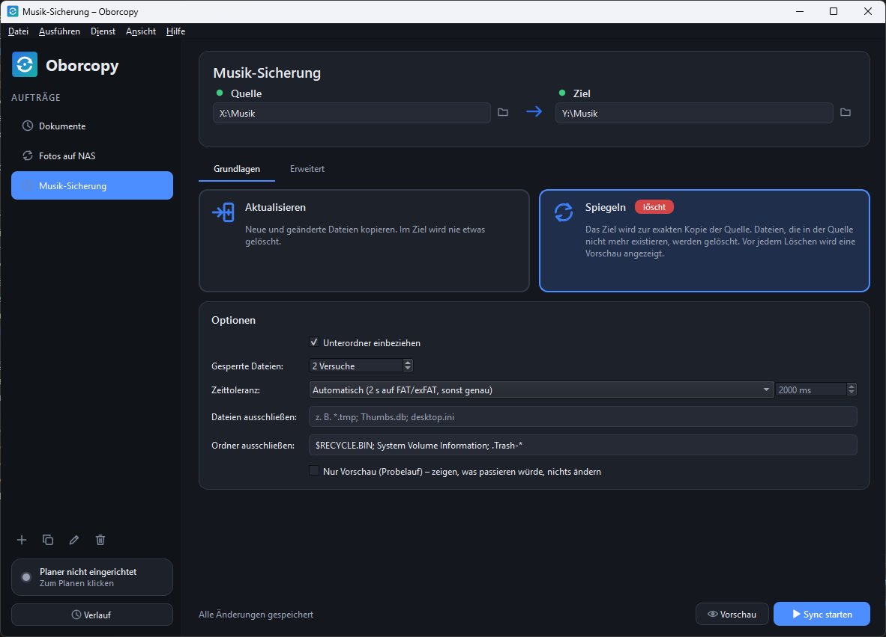

### 11.2 Sprache

Oborcopy spricht **Deutsch** und **Englisch**. Wählen Sie *Ansicht → Sprache → System, English* oder *Deutsch*:

* **System** (Vorgabe) – Deutsch, wenn Ihr Betriebssystem auf Deutsch eingestellt ist, sonst Englisch.
* **English** / **Deutsch** – immer diese Sprache. Die Sprachen stehen in ihrer eigenen Sprache im Menü, damit Sie den Weg zurück auch finden, wenn Sie die aktuelle Sprache nicht lesen.

Oborcopy fragt *„Oborcopy jetzt neu starten?“* – die neue Sprache gilt nach dem Neustart. Läuft gerade eine Synchronisation, fragt Oborcopy zuerst, ob sie abgebrochen werden soll; Sie können Oborcopy auch später selbst neu starten.

> **Gut zu wissen:** Protokolldateien, Berichte, das Kommandozeilenwerkzeug und das Dienstprotokoll bleiben immer **Englisch**, damit sie auf jedem Computer gleich aussehen. Meldungen des Betriebssystems (z. B. *„Zugriff verweigert“*) erscheinen in der Sprache Ihres Betriebssystems.

---

## 12. So schützt Oborcopy Ihre Daten

Oborcopy ist so gebaut, dass ein Fehler Ihre Sicherung nicht zerstört:

1. **Erst schauen, dann handeln** – zuerst wird alles verglichen; bevor Sie die Synchronisation starten, wird nichts geändert.
2. **Bestätigung von Löschungen** – im Modus Spiegeln sehen Sie jede Datei, die gelöscht wird, und müssen das Löschen bestätigen.
3. **Warnung bei zu vielen Löschungen** – eine rote Warnung, wenn ein ungewöhnlich großer Teil der Sicherung gelöscht würde.
4. **Schutz bei leerer Quelle** – ist der Quellordner leer (z. B. Datenträger nicht angeschlossen), wird die Synchronisation angehalten.
5. **Ordnerprüfung** – das Ziel darf weder die Quelle sein noch darin liegen.
6. **Prüfung des richtigen Datenträgers** – auf einen anderen Datenträger, der den alten Laufwerksbuchstaben bekommen hat, wird nie synchronisiert; stattdessen wird der Datenträger des Auftrags unter seinem neuen Buchstaben gefunden.
7. **Keine halb kopierten Dateien** – jede Datei wird zuerst unter einem vorläufigen Namen geschrieben und erst umbenannt, wenn sie vollständig ist. Selbst ein Stromausfall hinterlässt keine kaputten Dateien.
8. **Archivieren statt löschen** – auf Wunsch werden gelöschte Dateien in `.oborcopy-archive` aufbewahrt.
9. **Wiederholungen** – Dateien, die kurz benutzt werden, werden automatisch erneut versucht.
10. **Protokolle** – jeder Lauf wird dokumentiert.

---

## 13. Fragen und Problemlösungen

**Die erste Synchronisation dauert lange – ist das normal?**
Ja. Der erste Lauf kopiert alles. Spätere Läufe kopieren nur Änderungen und sind viel schneller.

**Jede Synchronisation kopiert wieder alle Dateien. Warum?**
* Prüfen Sie, ob unter Erweitert → *Zeitstempel & Attribute* die Option **Änderungszeiten der Dateien beibehalten** eingeschaltet ist.
* Lassen Sie die *Zeittoleranz* auf **Automatisch** (nötig für FAT/exFAT-Datenträger).
* Passiert es nach der Zeitumstellung im Frühling/Herbst, schalten Sie **Genau 1 Stunde Unterschied ignorieren** ein (Erweitert → Vergleich & Prüfung).

**Oborcopy meldet „Der Quellordner ist leer, das Ziel aber nicht“.**
Wahrscheinlich ist der Quelldatenträger nicht angeschlossen oder der falsche Ordner gewählt. Dieser Schutz verhindert, dass Ihre Sicherung gelöscht wird. Prüfen Sie den Quellordner.

**Wie stelle ich Dateien aus meiner Sicherung wieder her?**
Die Sicherung ist ein normaler Ordner mit normalen Dateien – kopieren Sie die Dateien einfach mit dem Explorer / Dateimanager zurück. Oder legen Sie einen Auftrag mit der Sicherung als Quelle und dem ursprünglichen Ort als Ziel an (zur Sicherheit im Modus **Aktualisieren**).

**Kann ich Netzlaufwerke oder ein NAS verwenden?**
Ja – wählen Sie den Netzwerkordner wie jeden anderen Ordner (z. B. `\\nas\backup` unter Windows oder eine eingehängte Freigabe unter Linux). *Parallele Kopien* (Erweitert) können Netzwerkkopien beschleunigen.

**Ich habe bei einer Datei nur die Groß-/Kleinschreibung geändert (z. B. `lied.mp3` → `Lied.mp3`).**
Unter Windows gilt das nicht als Änderung; die Datei wird nicht erneut kopiert.

**Kann ich den Computer während einer Synchronisation weiter benutzen?**
Ja. Verwenden Sie **Pause**, wenn Sie kurz die volle Geschwindigkeit des Datenträgers brauchen.

**Warum sind die Protokolldatei und die Aktivitätsliste auf Englisch?**
Protokolle bleiben absichtlich immer Englisch, damit sie überall gleich aussehen und bei einer Fehlermeldung leicht verglichen werden können ([Abschnitt 11.2](#112-sprache)).

**Linux: „could not load the Qt platform plugin xcb“.**
Installieren Sie die grundlegenden Grafikbibliotheken Ihrer Distribution, z. B. unter Ubuntu:
`sudo apt install libgl1 libegl1 libxkbcommon-x11-0 libfontconfig1`

**Wo sehe ich, was bei einem automatischen Lauf passiert ist?**
Öffnen Sie Oborcopy → **Verlauf** (Spalte *Gestartet von* = **Planer**) oder die Dienstverwaltung → **Details zum letzten Lauf** / **Dienstprotokoll**.

**Eine geplante Sicherung ist nicht gelaufen.**
Prüfen Sie die Statusanzeige: Der Dienst muss **laufen** und darf nicht pausiert sein, und der Zeitplan muss auf **Ein** stehen. War der Computer aus oder im Energiesparmodus? Dann läuft der Auftrag nach dem Start nur, wenn *Eine verpasste Sicherung nach dem Start einmal nachholen* angekreuzt ist. War die Sicherungsfestplatte angeschlossen? Kreuzen Sie *Wiederholen, wenn der Lauf fehlschlägt* an, damit der Auftrag es etwas später erneut versucht. Das **Dienstprotokoll** zeigt jeden Start und sein Ergebnis.

**Die Dienstverwaltung meldet „Windows konnte den Dienst nicht mit Ihrem Konto anmelden“.**
Ihr Windows-Kennwort hat sich geändert. Klicken Sie auf **Kennwort aktualisieren…** und geben Sie das neue Kennwort ein.

---

## 14. Tastenkürzel und Version

| Taste | Aktion |
|---|---|
| `F5` | Sync starten |
| `F6` | Vorschau |
| `F7` | Pause / Fortsetzen |
| `Umschalt+F5` | Laufende Synchronisation abbrechen |
| `Strg+N` | Neuer Auftrag |
| `Strg+S` | Auftrag speichern (geschieht auch automatisch) |
| `Strg+H` | Verlauf |
| `Strg+M` | Dienstverwaltung (geplante Sicherungen) |
| `Alt+F4` | Beenden (Windows; unter Linux auch `Strg+Q`) |
| `Alt+G`, `Alt+S` | Im Bestätigungsfenster: Kästchen ankreuzen, Synchronisation starten |

### 14.1 Versionsinformationen

*Hilfe → Über Oborcopy* zeigt die Version, das Erstellungsdatum und technische Angaben – bitte geben Sie diese an, wenn Sie ein Problem melden. *Hilfe → Über die Entwickler* zeigt, wer Oborcopy gebaut hat, mit Links.

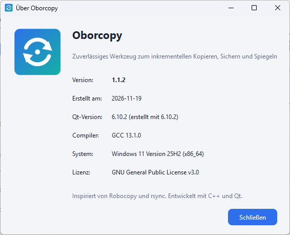

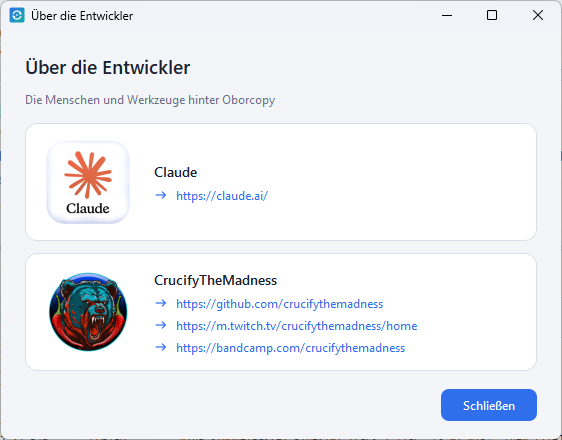

---

## 15. Begriffe

| Begriff | Erklärung |
|---|---|
| **Quelle** | Der Ordner, der gesichert wird. Oborcopy liest nur daraus (außer bei *Dateien verschieben*). |
| **Ziel** | Der Ordner, der die Kopie erhält. |
| **Auftrag** | Gespeicherte Einstellungen für eine Sicherungsaufgabe. |
| **Modus Aktualisieren** | Kopiert neue und geänderte Dateien; löscht nie. |
| **Modus Spiegeln** | Macht das Ziel gleich wie die Quelle, einschließlich Löschungen. |
| **Vorschau / Probelauf** | Zeigt, was passieren würde, ohne etwas zu ändern. |
| **Synchronisation (Sync)** | Ein Lauf eines Auftrags, der das Ziel auf den Stand der Quelle bringt. |
| **Überzählige Datei** | Eine Datei, die es im Ziel gibt, aber (nicht mehr) in der Quelle. |
| **FAT / exFAT** | Dateisysteme von USB-Sticks und vielen externen Festplatten; sie speichern Dateizeiten in 2-Sekunden-Schritten. |
| **Zeittoleranz** | Wie stark Dateizeiten abweichen dürfen und trotzdem als gleich gelten. |
| **Archivordner** | `.oborcopy-archive` im Ziel – erhält gelöschte Dateien, wenn diese Option eingeschaltet ist. |
| **Oborcopy Scheduler (Planer)** | Der Hintergrunddienst, der Ihre Aufträge zu festen Zeiten ausführt, auch wenn Oborcopy geschlossen ist. |
| **Protokolldatei** | Textdatei mit allem, was während eines Laufs passiert ist (auf Englisch). |

---

<p align="center"><em>Oborcopy 1.1.2 – Benutzerhandbuch</em></p>
