<div class="cover" align="center">


# Oborcopy User Guide

**Back up and mirror your folders – safely and step by step**

Version 1.1.0 · for Windows 10/11 and Linux

</div>

## Contents

1. [What is Oborcopy?](#1-what-is-oborcopy)
2. [Installation](#2-installation)
3. [Quick start – your first backup in 6 steps](#3-quick-start--your-first-backup-in-6-steps)
4. [The main window](#4-the-main-window)
5. [Managing jobs](#5-managing-jobs)
6. [Step by step: running a sync](#6-step-by-step-running-a-sync)
7. [Reading the results](#7-reading-the-results)
8. [Advanced options](#8-advanced-options)
9. [Weekly backups – the recommended routine](#9-weekly-backups--the-recommended-routine)
10. [Automatic backups](#10-automatic-backups)
11. [Settings, log files and where things are stored](#11-settings-log-files-and-where-things-are-stored)
12. [How Oborcopy protects your data](#12-how-oborcopy-protects-your-data)
13. [Questions and troubleshooting](#13-questions-and-troubleshooting)
14. [Keyboard shortcuts and version](#14-keyboard-shortcuts-and-version)
15. [Glossary](#15-glossary)

---

## 1. What is Oborcopy?

Oborcopy keeps a **copy of a folder up to date** – for example your music collection on one disk and its backup on another disk. The first run copies everything. Every later run only copies what has **changed**, so a weekly backup usually takes just seconds or minutes.

Oborcopy works with two modes:

| Mode | What it does | Typical use |
|---|---|---|
| **Update** | Copies new and changed files to the destination. **Nothing is ever deleted** in the destination. | Collecting files, "add only" backups |
| **Mirror** | Like Update, and in addition **deletes files in the destination that no longer exist in the source**. Afterwards both folders are identical. | An exact backup of your music, photos or documents |

> **Example:** You removed an album from your music collection. With **Update** the album stays on the backup disk. With **Mirror** it is also removed from the backup disk – but only after Oborcopy has shown you the list and you have confirmed it.

Words used in this guide:

* **Source** – the folder you want to back up (e.g. `D:\Music`).
* **Destination** – the folder that receives the copy (e.g. `E:\Music`).
* **Job** – a saved set of settings: source, destination, mode and options. You can save as many jobs as you like.

---

## 2. Installation

Oborcopy does not need an installer. You unpack it and start it.

### 2.1 Windows 10 / 11

1. Unpack `Oborcopy-1.1.0-win64.zip` to a folder of your choice, for example `C:\Tools\Oborcopy`.
2. Double-click **`Oborcopy.exe`**.
3. *Optional:* right-click `Oborcopy.exe` → **Show more options → Send to → Desktop (create shortcut)**.

> **Note:** Keep all files of the folder together – the DLL files and sub-folders are needed.
>
> If Windows shows *"Windows protected your PC"* (SmartScreen) the first time, click **More info → Run anyway**. This appears for programs downloaded from the internet that are not signed by a publisher.

### 2.2 Linux

Requirements: 64-bit Linux, as new as Ubuntu 24.04 or newer (e.g. Linux Mint 22, Debian 13, Fedora 40), with a normal desktop. Everything else is included.

1. Unpack the archive in a terminal:
   ```
   tar xzf oborcopy-1.1.0-linux-x86_64.tar.gz
   ```
2. Start Oborcopy:
   ```
   cd oborcopy-1.1.0-linux-x86_64
   ./oborcopy
   ```
3. *Optional:* add Oborcopy to your application menu:
   ```
   ./install-desktop-entry.sh
   ```
   (Run it again if you move the folder later.)

---

## 3. Quick start – your first backup in 6 steps

When you start Oborcopy for the first time, it creates an empty job called **My Backup**:

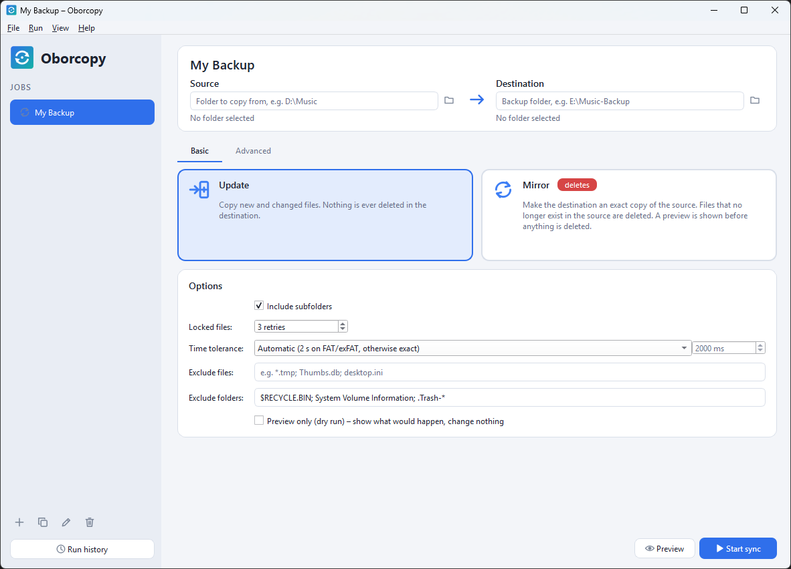

1. **Source:** click the folder icon next to *Source* and choose the folder you want to back up (e.g. your music folder).
2. **Destination:** click the folder icon next to *Destination* and choose the folder on your backup disk. It may be empty or not exist yet.
3. **Mode:** click the card **Update** (never deletes) or **Mirror** (exact copy).
4. **Preview:** click **Preview** at the bottom right. Oborcopy shows what it *would* do – nothing is changed yet. Close the preview.
5. **Start:** click **Start sync**. In Mirror mode you confirm the deletions once more (see [section 6.3](#63-confirming-a-mirror-sync)).
6. **Result:** at the end you see a summary such as *"1,204 files checked, 37 copied, 12 updated, 7 deleted, 0 errors"*. Click **Show details** for the full list.

That's it. Your settings are saved automatically – next week you only click **Start sync** again.

---

## 4. The main window

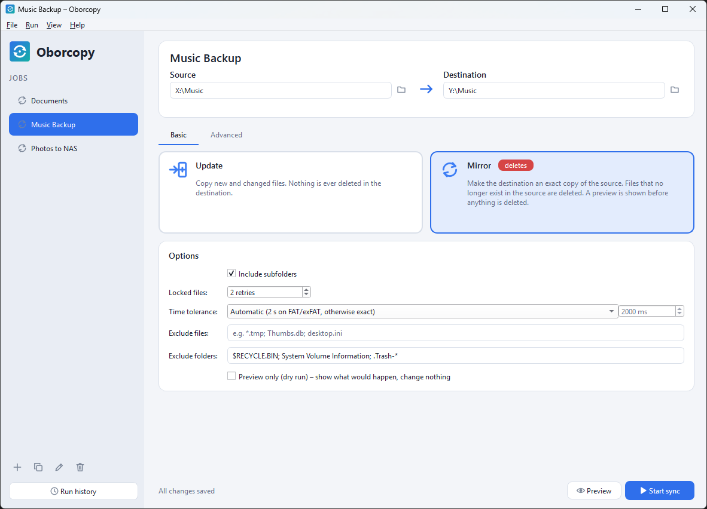

| Area | What you find there |
|---|---|
| **Sidebar (left)** | Your jobs. Click a job to open it. The buttons below the list create **(+)**, duplicate, rename and delete jobs. **Run history** shows earlier runs. |
| **Job header (top)** | The job name, **Source** and **Destination**. Below each folder Oborcopy shows information about the disk, e.g. *"exFAT · 412 GB free of 1.8 TB · 2 s timestamps"*. |
| **Basic tab** | The mode cards **Update** / **Mirror** and the most important options. Most users never need more. |
| **Advanced tab** | All further options, grouped into sections ([section 8](#8-advanced-options)). |
| **Action bar (bottom)** | **Preview** and **Start sync**. While a sync is running: **Pause/Resume** and **Cancel**. On the left a status text, e.g. *"All changes saved"*. |
| **Menu bar** | *File* (new job, save, run history, log folder, exit), *Run* (start, preview, pause, cancel), *View* (theme), *Help* (About). |

### 4.1 Choosing folders

There are three ways to enter a folder:

* click the **folder icon** and pick the folder,
* **type or paste** the path into the field, or
* **drag a folder** from Explorer / your file manager **onto the field**.

A **dot** in front of *Source* and *Destination* shows whether the folder can be reached right now. Oborcopy checks this every few seconds, so it changes as soon as you plug in or unplug a disk or a network drive goes offline:

| Dot | Meaning |
|---|---|
| 🟢 green | **Online** – the folder is reachable. For the destination also: *folder does not exist yet – it will be created* (its parent folder exists). |
| 🔴 red | **Offline** – the disk is not connected, the network share is not reachable or the folder was not found. |
| ⚪ grey | No folder chosen yet, or the check is still running. |

**Preview** and **Start sync** (and `F5`/`F6`) are only available while both dots are green. The line at the bottom of the window tells you which folder is missing.

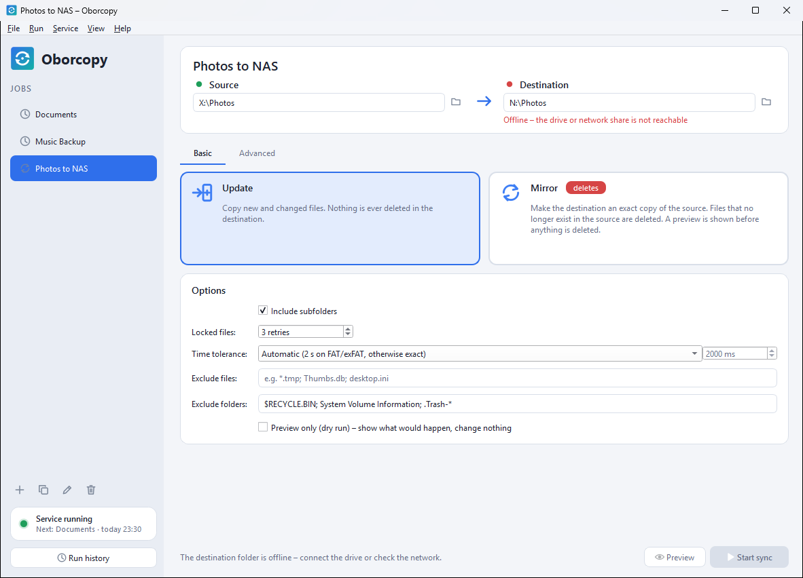

### 4.2 The Basic options

| Option | Meaning | Recommendation |
|---|---|---|
| **Include subfolders** | Also copy everything inside sub-folders. | On |
| **Locked files** | How often a file that is in use by another program is tried again. The wait grows each time (2 s, 4 s, 8 s …). | 3 retries |
| **Time tolerance** | How exact the file times must match to count as "unchanged". *Automatic* allows 2 seconds on FAT/exFAT disks (USB sticks, many external disks) – otherwise every file would look changed. | Automatic |
| **Exclude files** | Files that are skipped, separated by `;`. Wildcards: `*` = any text, `?` = one character. Example: `*.tmp; Thumbs.db; desktop.ini` | as needed |
| **Exclude folders** | Folders that are skipped. Windows system folders are excluded already. | keep the defaults |
| **Preview only (dry run)** | Every run only shows what would happen – nothing is changed. | Off |

> **Good to know:** Excluded files are neither copied nor deleted – also not in Mirror mode.

---

## 5. Managing jobs

A **job** stores everything about one backup task. Create one job per task, e.g. *Music Backup*, *Photos to NAS*, *Documents*.

| Action | How |
|---|---|
| **Create a job** | Click **+** below the job list (or *File → New job…*, `Ctrl+N`) and enter a name. |
| **Open a job** | Click it in the list. |
| **Rename** | Double-click the job, or click the pencil button. |
| **Duplicate** | Select the job and click the duplicate button – useful for a second backup disk with the same settings. |
| **Delete** | Click the trash button. Only the job settings are removed – **no files are touched**. |
| **Save** | Not needed: every change is saved automatically within a second. |

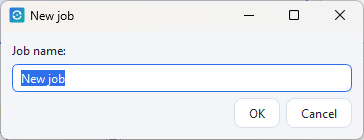

---

## 6. Step by step: running a sync

The following example uses the job **Music Backup** in **Mirror** mode: the music collection on `X:\Music` is mirrored to the backup disk `Y:\Music`. Since the last backup two albums were added, one track was re-ripped and one album was removed.

### 6.1 Preview – see what will happen

Click **Preview** (or press `F6`). Oborcopy scans both folders and compares them. **Nothing is changed.**

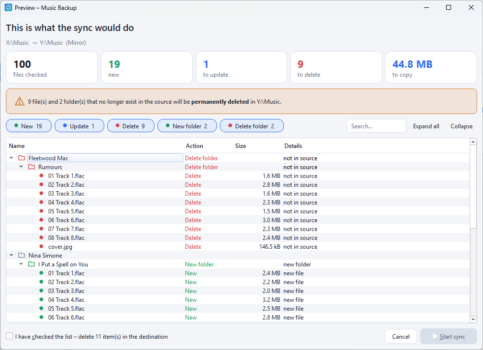

At the top you see the numbers: files checked, **new** files, files **to update**, files **to delete**, and how much data will be copied.

Below is a **folder tree** with every planned action:

* <span style="color:#1E9E5A">●</span> **New** – the file does not exist in the destination yet.
* <span style="color:#2F6FEB">●</span> **Update** – the file exists but is different (newer, older or a different size).
* <span style="color:#D64545">●</span> **Delete** – the file exists only in the destination (Mirror mode only).

The coloured buttons above the tree (*New 19*, *Update 1*, *Delete 9*, …) are **filters**: click one to hide or show that kind of entry. Use **Search…** to find a file, **Expand all / Collapse** to open or close the folders.

If everything looks right you can click **Start sync** directly in the preview – or **Cancel** to go back without changes.

> **Tip:** If the preview says *"Everything is up to date"*, there is nothing to do.

### 6.2 Starting the sync

Click **Start sync** (or press `F5`).

* In **Update** mode, or when nothing has to be deleted, the sync starts immediately.
* In **Mirror** mode with deletions, Oborcopy first shows the confirmation window.

### 6.3 Confirming a Mirror sync

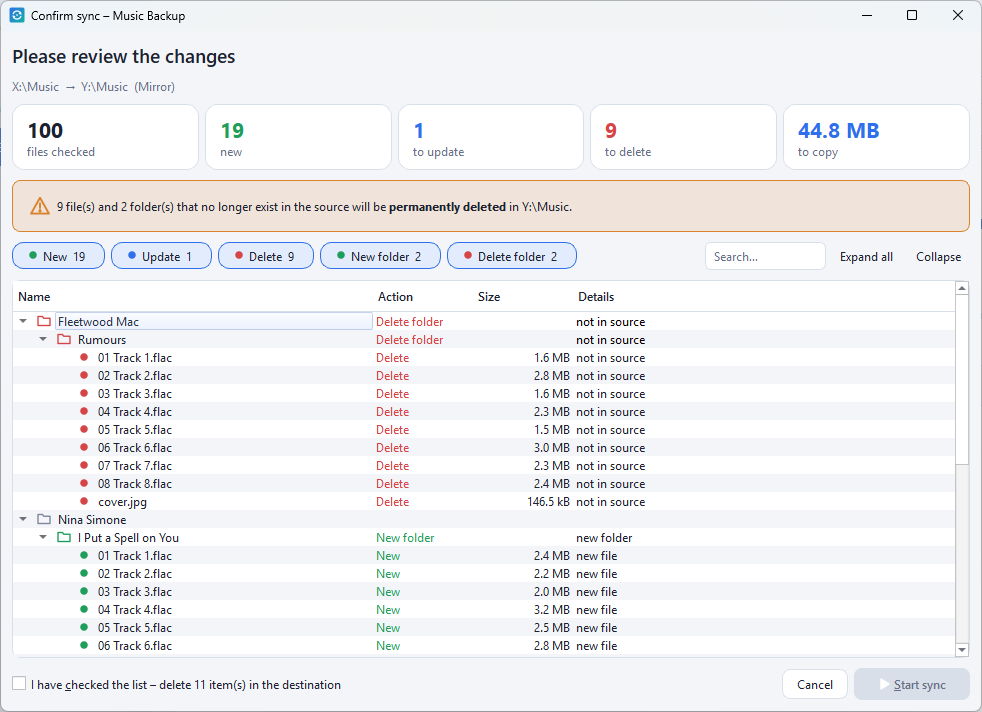

This window looks like the preview. The orange box tells you **how many files and folders will be deleted** and **where**. The **Start sync** button stays grey until you tick the box at the bottom:

**☑ I have checked the list – delete 11 item(s) in the destination**

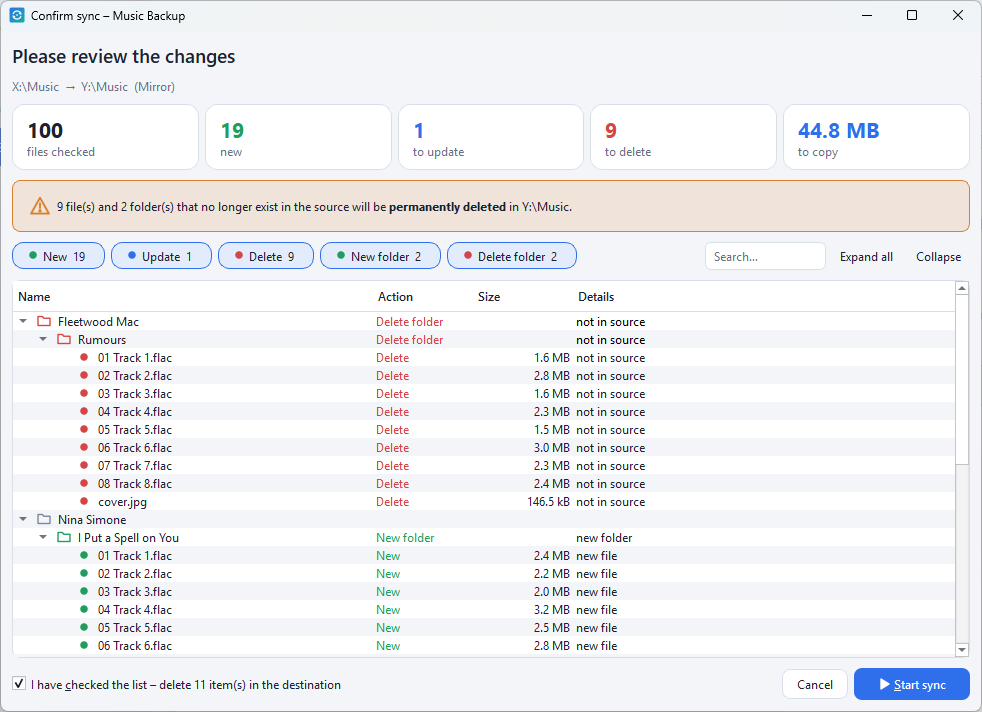

Then click **Start sync**.

> **Red warning?** If a large part of the backup would be deleted (more than 20 % by default), Oborcopy shows an additional **red warning**. This usually means that the **wrong source folder** was selected or that the **source disk is not connected**. Click **Cancel** and check the source first.

### 6.4 Watching the progress

While the sync is running, the options are replaced by the progress view:

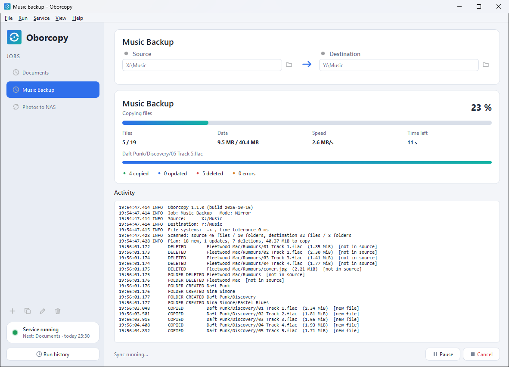

* **Percentage and bar** – overall progress (by amount of data).
* **Files** – files copied so far / files to copy.
* **Data**, **Speed**, **Time left** – amount copied, current speed and estimated remaining time.
* **Current file** with its own small progress bar.
* **Counters** – copied, updated, deleted, errors so far.
* **Activity** – a live list of everything Oborcopy does.

You can keep using your computer – Oborcopy stays responsive the whole time.

### 6.5 Pause, resume or cancel

* **Pause** (`F7`) – stops copying after the current block of data; the button changes to **Resume**. Useful if you need the full disk speed for something else for a moment.
* **Cancel** (`Shift+F5`) – stops the sync. Files already copied stay in the destination; the file that was being copied is discarded, so there are **never half-copied files** in your backup. Simply start the sync again later – Oborcopy continues where it stopped.

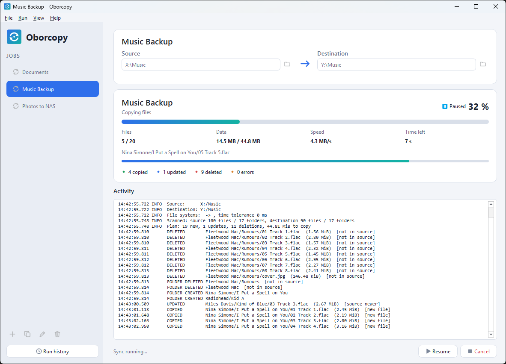

### 6.6 The result

When the sync is done, a result line appears at the top:

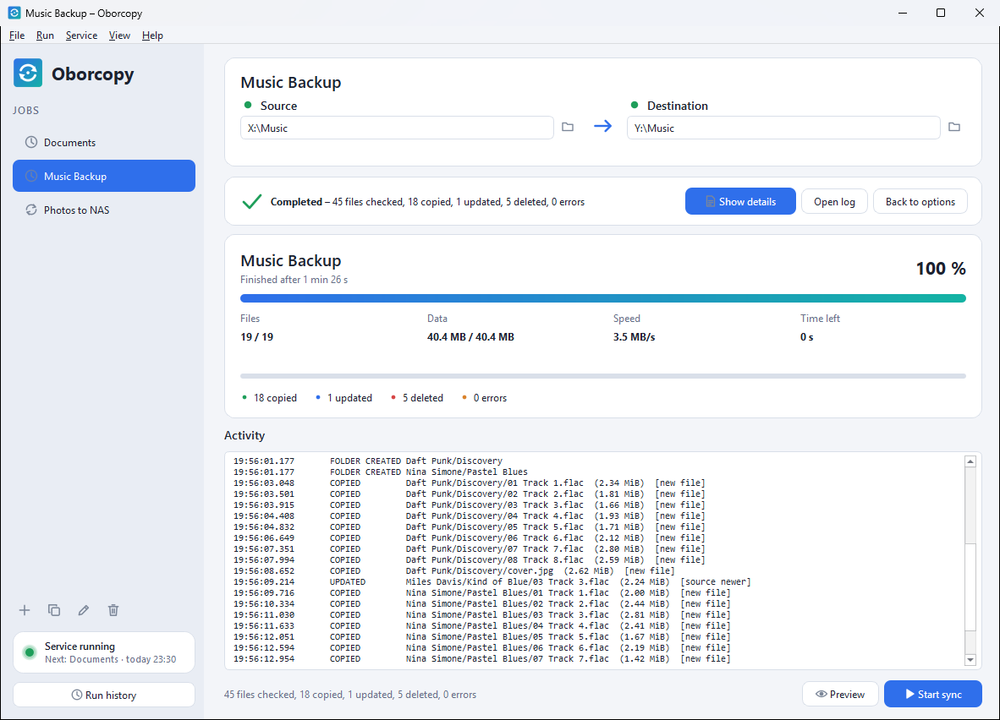

| Symbol | Meaning |
|---|---|
| Green check ✔ | **Completed** – everything worked. |
| Orange triangle ⚠ | **Completed with errors** – most files were copied, some could not be (see [section 7.2](#72-understanding-errors)). |
| Grey square ■ | **Cancelled** – you stopped the sync. |
| Red cross ✖ | **Failed** – the sync could not run (e.g. the source folder does not exist). The reason is shown. |

Buttons:

* **Show details** – opens the detailed summary ([section 7](#7-reading-the-results)).
* **Open log** – opens the log file of this run in a text editor.
* **Back to options** – returns to the job settings.

---

## 7. Reading the results

### 7.1 The detailed summary

Click **Show details** after a sync, or open any earlier run from the **Run history**.

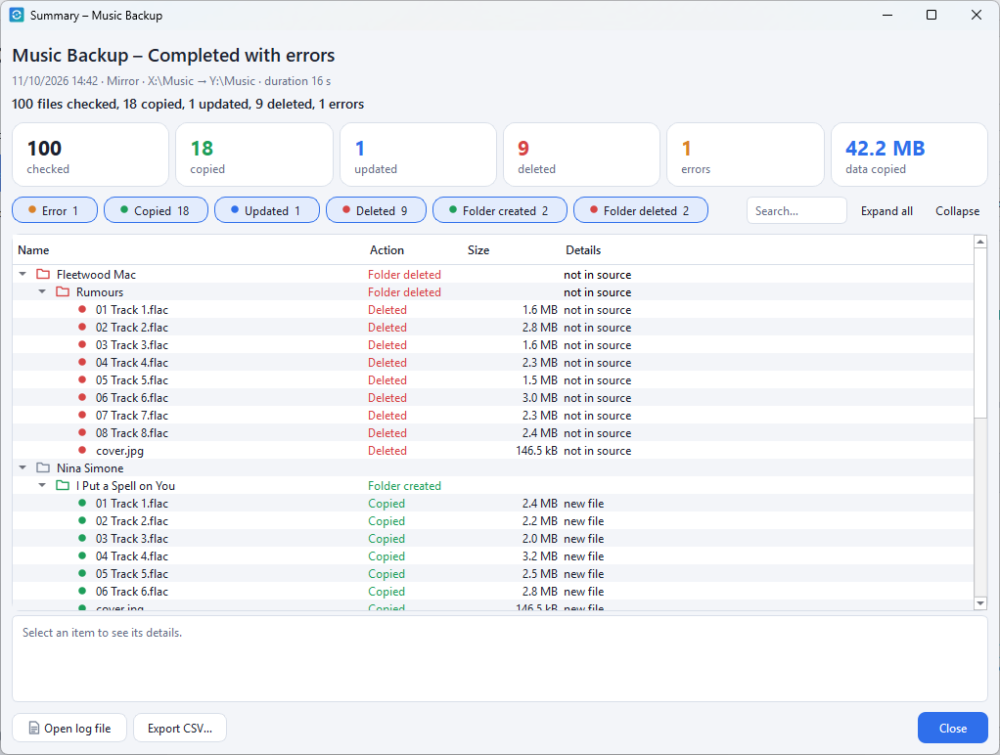

* **Top:** job name and result, date, mode, folders and duration, then the summary line, e.g. *"100 files checked, 18 copied, 1 updated, 9 deleted, 1 errors"*.
* **Tiles:** checked, copied, updated, deleted, errors and amount of data copied.
* **Filter buttons:** *Error*, *Copied*, *Updated*, *Deleted*, *Folder created*, *Folder deleted* – click to show or hide each group.
* **Folder tree:** every file that was copied, updated or deleted, in its folder.
* **Details area (bottom):** click an entry to see the full source and destination path, size and reason.
* **Open log file** / **Export CSV…** – the CSV file opens in Excel or LibreOffice Calc.

### 7.2 Understanding errors

An error means that one file could not be processed – **all other files were still synced**. To see only the errors, switch off all filter buttons except **Error**, then click the file:

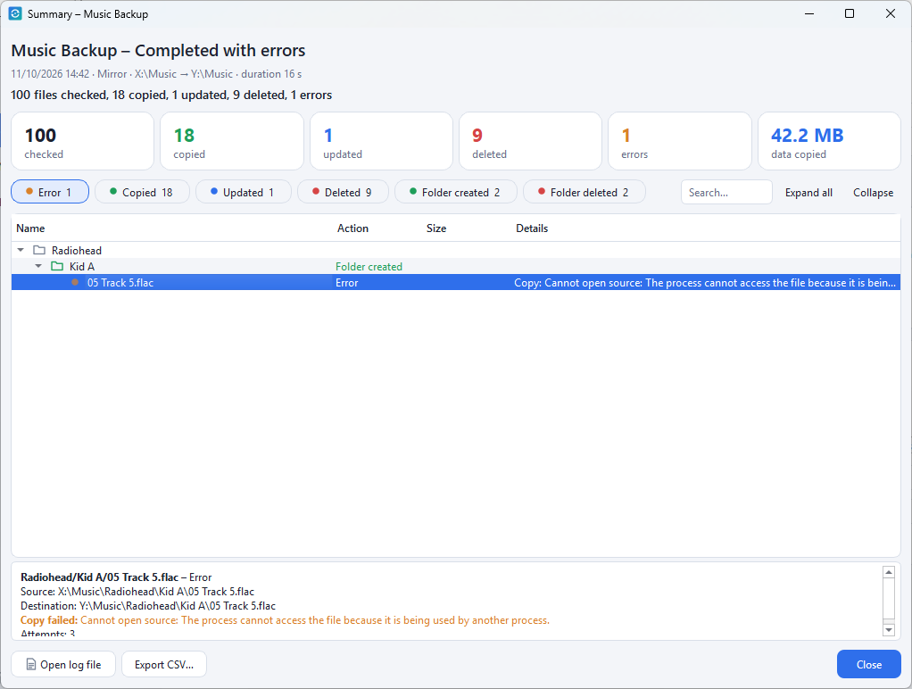

The details show what was attempted, the message from the operating system and how many attempts were made. In this example the file was **open in another program** ("being used by another process"); Oborcopy tried 3 times and then moved on.

**What to do:** close the program that uses the file (or wait until it is finished) and simply run the sync again. Only the missing file will be copied.

Common messages:

| Message | Cause | Solution |
|---|---|---|
| *being used by another process* | The file is open in another program. | Close the program, run again. Increase *Locked files* retries if it happens often. |
| *Access is denied* / *Permission denied* | No permission to read the source or write the destination. | Check the folder permissions; on Windows, the file may be read-only on a protected location. |
| *Source file no longer exists* | The file was deleted or moved while the sync was running. | Nothing to do. |
| *No space left on device* / disk full | The destination disk is full. | Free space or use a bigger disk. The preview warns about this in advance. |

### 7.3 Run history

Click **Run history** in the sidebar (or *File → Run history…*, `Ctrl+H`) to see all earlier runs of all jobs:

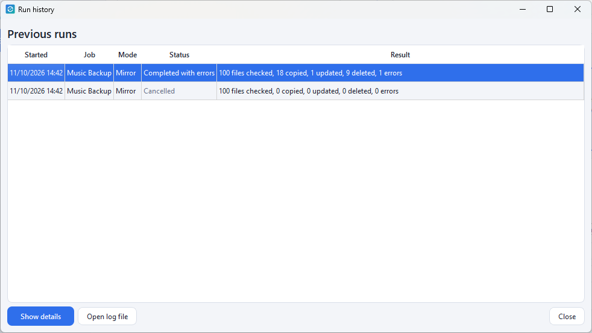

Select a run and click **Show details** (or double-click it) to open its summary, or **Open log file** to read its log.

---

## 8. Advanced options

The **Advanced** tab contains the remaining options in sections. Click a section title to open or close it. The defaults are chosen so that you normally don't need to change anything here.

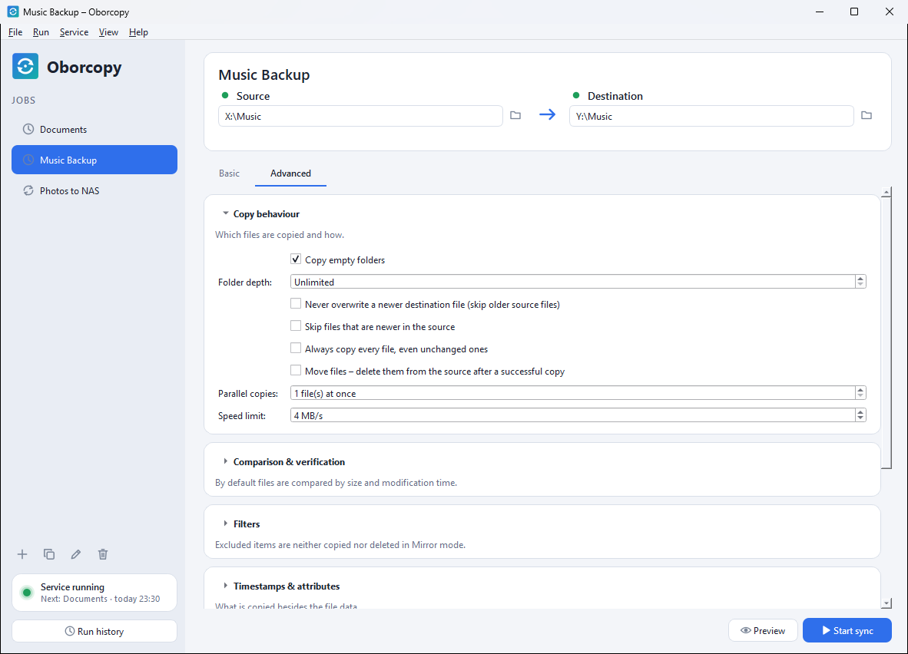

### 8.1 Copy behaviour

| Option | Meaning |
|---|---|
| **Copy empty folders** | Also create folders that contain no files. |
| **Folder depth** | *Unlimited*, or only the first *n* folder levels (1 = only the files directly in the source folder). |
| **Never overwrite a newer destination file** | If the file in the destination is newer than the source, keep it. |
| **Skip files that are newer in the source** | Only copy new files and files that became older (rarely needed). |
| **Always copy every file** | Copy everything, even unchanged files (slow – for special cases). |
| **Move files** | Delete each file from the **source** after it was copied successfully. ⚠ Use with care. |
| **Parallel copies** | Copy several files at the same time. Helpful for SSDs and network drives; for normal hard disks 1 is usually fastest. |
| **Speed limit** | Limit the copy speed in MB/s, e.g. to keep a network usable. *Unlimited* = full speed. (In the screenshot a limit of 4 MB/s is set.) |

### 8.2 Comparison & verification

| Option | Meaning |
|---|---|
| **Ignore exact 1-hour differences** | Prevents re-copying everything after the switch to/from daylight saving time on FAT disks. Turn on if you see all files being "updated" twice a year. |
| **Compare file contents (SHA-256)** | Also compares the actual contents of files that look unchanged. Finds silent changes, but reads every file – much slower. |
| **Verify every copied file** | After copying, the copy is read again and compared with the original. Recommended for very valuable data; takes about twice as long. |

### 8.3 Filters

| Option | Meaning |
|---|---|
| **Only files** | Copy only matching files, e.g. `*.mp3; *.flac`. Empty = all files. |
| **Minimum / Maximum size** | Skip files that are smaller / larger than the given size (MB). |
| **Skip files newer / older than** | Skip files by age in days. |
| **Skip hidden / system files** | Skip hidden files and folders, or Windows system files. |
| **Links** | Skip symbolic links and junctions (default) or follow them and copy their target. |

### 8.4 Timestamps & attributes

Keep **file modification times** switched on – Oborcopy needs them to recognise unchanged files next time. Folder times, Windows attributes (read-only, hidden …) and Linux permissions can also be kept.

### 8.5 Retry timing

**First wait** (default 2 s) and **Longest wait** (default 60 s) for locked files. The wait doubles with every attempt. The number of attempts is set on the Basic tab.

### 8.6 Mirror safety

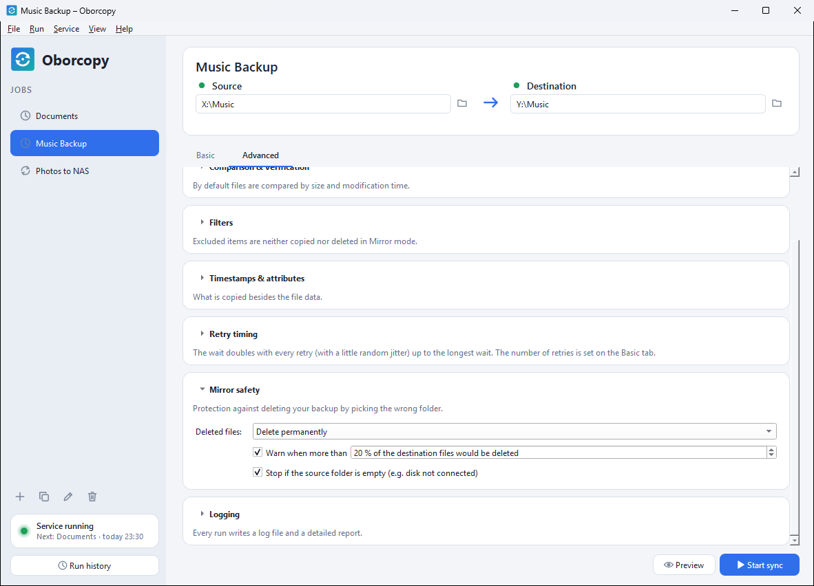

| Option | Meaning |
|---|---|
| **Deleted files** | *Delete permanently* (default), or *Move to archive folder*: deleted files are moved into the folder **`.oborcopy-archive`** in the destination (sorted by date and time) instead of being deleted. You can restore them from there or delete the archive later yourself. |
| **Warn when more than … % … would be deleted** | Shows a red warning in the confirmation window (and stops automatic command-line runs) when many files would be deleted. Default 20 %. |
| **Stop if the source folder is empty** | Prevents wiping your backup when the source disk is not connected. Keep it on. |

### 8.7 Logging

| Option | Meaning |
|---|---|
| **Log folder** | Where log files are stored. Empty = default location ([section 11](#11-settings-log-files-and-where-things-are-stored)). |
| **Detail** | *Summary only*, *Changes* (every copied/updated/deleted file – recommended) or *All files* (also unchanged files – large logs). |
| **Keep logs of the last** | Older logs of this job are deleted automatically (default: 50 runs). |

---

## 9. Weekly backups – the recommended routine

For a music collection (or photos, documents …) with one backup disk:

**Once – set up the job**

1. Create a job, e.g. *Music Backup*.
2. Source = your music folder, Destination = a folder on the backup disk.
3. Choose **Mirror**.
4. *Optional:* Advanced → Mirror safety → **Move to archive folder** for extra safety.

**Every week**

1. Connect the backup disk.
2. Start Oborcopy, select the job.
3. Click **Start sync**.
4. If files will be deleted, look at the list in the confirmation window. Are these really files you removed on purpose? Then tick the box and click **Start sync**.
5. Check the result line. If it shows errors, open **Show details**.
6. Safely remove ("eject") the backup disk.

> **Tip:** Keep a second backup disk at another place (e.g. at work or with family) and create a second job for it with **Duplicate**.

---

## 10. Automatic backups

Oborcopy can run your jobs automatically at set times – every few hours, daily, weekly or monthly. The easiest way is the built-in **Oborcopy Scheduler** service (10.1 – 10.5). If you prefer, you can still use the command-line tool with the Windows Task Scheduler or cron (10.6 – 10.8).

### 10.1 The Oborcopy Scheduler service

The Oborcopy Scheduler is a small background program that is installed as a real service of your operating system:

* **Windows:** it appears in *Services* (`services.msc`) as **Oborcopy Scheduler** and starts automatically with Windows.
* **Linux:** it is a *systemd user service* (`oborcopy.service`) of your account. Check it with `systemctl --user status oborcopy`.

The service runs **under your own user account**. That is why it sees the same jobs, the same folders and the same network shares (e.g. `\\nas\backup`) as Oborcopy itself. You can **close Oborcopy** – the service keeps running and starts your jobs on time. Oborcopy is only the *Service Manager*: you use it to set up, control and check the service.

The service runs one job at a time with `oborcopy-cli` and writes the normal log file and run report – so every automatic run appears in the **Run history**.

### 10.2 Installing the service

1. Open *Service → Service Manager…* (`Ctrl+M`) or click the **status pill** in the sidebar above *Run history*.
2. Click **Install service…**.
3. **Windows:** confirm the administrator question (UAC). Windows then asks for **your Windows password** – the service needs it to log on as you. Use your password, not a Windows Hello PIN. Oborcopy never sees or stores the password; Windows keeps it.
   **Linux:** nothing to confirm – no root password is needed. Oborcopy also enables *linger*, so the service keeps running after you log out and starts at boot. If your system does not allow that, Oborcopy shows a note; the service then runs while you are logged in.
4. The status changes to **Service running**.

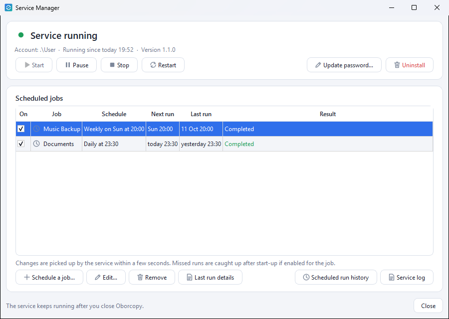

> **Tip:** If you change your Windows password later, the service can no longer log on. The Service Manager then shows an error – click **Update password…**.

### 10.3 Scheduling a job

1. In the Service Manager click **Schedule a job…** – or select a job in the main window and choose *Service → Schedule this job…*.
2. Choose the **job** and how often it should run:
   * **Every few hours** – e.g. every 4 hours at minute :15 (00:15, 04:15, 08:15 …)
   * **Daily** – at a time, e.g. 23:30
   * **Weekly** – on the days you tick, e.g. Mon and Thu at 07:00
   * **Monthly** – on a day of the month, or on the **last day**. A day the month does not have (e.g. 31) runs on its last day.
3. Options:
   * **Run a missed backup once after start-up** – if the computer was off at the scheduled time, the job runs once when the service starts again.
   * **Allow deletions in Mirror mode** – needed for unattended Mirror jobs. The *Mirror safety* threshold (8.6) still applies: if too many files would be deleted, the run stops instead.
   * **Retry if the run fails** – useful when the backup disk or NAS is sometimes not reachable yet, e.g. right after start-up. Choose how often and how far apart, e.g. *up to 8 times, every 15 minutes* (= for up to 2 hours). Only runs that **failed** are retried (folder or disk not reachable); a run that completed with some errors or was stopped by the Mirror safety threshold is not. The Service Manager shows a pending retry in *Next run*, e.g. *08:15 (retry 2 of 8)*.
4. The preview at the bottom shows the next run times. Click **Save schedule**.

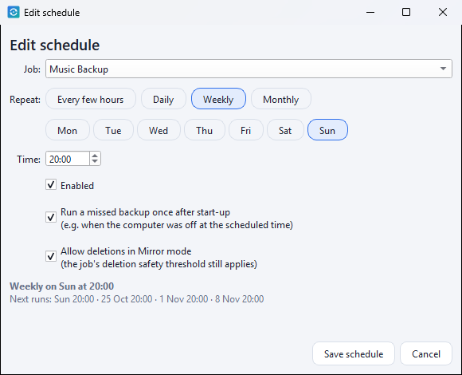

Scheduled jobs show a **clock icon** in the job list. Changes are picked up by the running service within a few seconds. Untick **On** in the list to switch a schedule off without deleting it.

### 10.4 Controlling the service

| Button | What it does |
|---|---|
| **Start** | Starts the stopped service. |
| **Pause / Resume** | While paused, no scheduled job starts. A job that is already running finishes. |
| **Stop** | Stops the service. A running job is cancelled cleanly (it shows as *Cancelled* in the history). |
| **Restart** | Stop + Start. |
| **Uninstall** | Removes the service. Your schedule is kept for a later installation. |

The **status pill** in the sidebar always shows what the service is doing:

| Pill | Meaning |
|---|---|
| 🟢 **Service running** · *Next: Music Backup · today 23:30* | Waiting for the next job (the dot pulses gently). |
| 🔵 **Backing up: Music Backup** | A scheduled job is running right now (faster pulse). |
| 🟠 **Service paused** | No job starts until you resume. |
| ⚪ **Service stopped** / **Scheduler not set up** | Scheduled jobs do not run. |
| 🔴 **Service error** | Click it to see the reason, e.g. a changed Windows password. |

If you move the Oborcopy folder or unpack a new version somewhere else, the Service Manager tells you that the service still uses the old folder – click **Use this Oborcopy**.

> **Before deleting the Oborcopy folder,** uninstall the service in the Service Manager.

### 10.5 Checking scheduled runs

* The Service Manager lists every scheduled job with its **next run**, **last run** and **result**. **Last run details** opens the detailed summary of the last run.
* **Scheduled run history** opens the Run history filtered to runs started by the scheduler. There you can use **Show details** and **Open log file** as usual. In the normal Run history, the column *Started by* shows **Scheduler** or **You**.
* **Service log** opens the service's own log (start, stop, schedule changes, every run).
* If you start a job in Oborcopy while the service is running the same job, Oborcopy warns you first.

### 10.6 The command-line tool

Besides the window program, Oborcopy includes the command-line tool **`oborcopy-cli`**. It runs a saved job without a window – useful for scripts or your own scheduler.

Example: `oborcopy-cli --job "Music Backup" --yes` runs the job *Music Backup* and allows deletions.

| Option | Meaning |
|---|---|
| `--list-jobs` | Show all saved jobs. |
| `--job "Name"` | Run the saved job with this name. |
| `--job-file file.json` | Run a job from a JSON file. |
| `--dry-run` | Only show what would happen. |
| `--yes` | Allow deletions in Mirror mode. **Without it, a Mirror run with deletions is stopped** – a safety measure. |
| `--force` | Run even if the "too many deletions" warning applies. |
| `--quiet` / `--verbose` | Less / more output. |
| `--help` | Show all options. |

When it finishes, `oborcopy-cli` returns a **result code**: 0 = nothing to do, 1 = files copied, 2 = files deleted, 3 = both, 8 = some files failed, 16 = the run could not be done or was stopped.

### 10.7 Windows: weekly backup with the Task Scheduler

1. Press the **Windows key**, type **Task Scheduler** and open it.
2. Click **Create Basic Task…** on the right.
3. Name: *Oborcopy Music Backup* → **Next**.
4. Trigger: **Weekly** → **Next** → choose the day and time (e.g. Sunday 20:00) → **Next**.
5. Action: **Start a program** → **Next**.
6. *Program/script:* browse to `oborcopy-cli.exe` (e.g. `C:\Tools\Oborcopy\oborcopy-cli.exe`).
   *Add arguments:* `--job "Music Backup" --yes --quiet`
   *Start in:* the Oborcopy folder (e.g. `C:\Tools\Oborcopy`) → **Next** → **Finish**.

Make sure the backup disk is connected at that time. Each automatic run appears in Oborcopy's **Run history** with its full summary.

### 10.8 Linux: weekly backup with cron

Open the cron table with `crontab -e` and add this line (Sunday 20:00 – use the path where you unpacked Oborcopy):

```
0 20 * * 0  /opt/oborcopy/oborcopy-cli --job "Music Backup" --yes --quiet
```

---

## 11. Settings, log files and where things are stored

| What | Windows | Linux |
|---|---|---|
| Jobs | `%LOCALAPPDATA%\Oborcopy\jobs\` | `~/.config/Oborcopy/jobs/` |
| Program settings (theme, window size) | `%LOCALAPPDATA%\Oborcopy\settings.json` | `~/.config/Oborcopy/settings.json` |
| Log files and run reports | `%LOCALAPPDATA%\Oborcopy\logs\` | `~/.local/share/Oborcopy/logs/` |
| Scheduler: schedule, status and service log | `%LOCALAPPDATA%\Oborcopy\service\` | `~/.config/Oborcopy/service/` |
| Scheduler service definition | Windows *Services* (`Oborcopy`) | `~/.config/systemd/user/oborcopy.service` |

* *File → Open log folder* opens the log folder directly.
* Each run writes a readable **`.log`** file and a **`.json`** report (used for the Run history).
* To **back up or move your jobs** to another computer, copy the `jobs` folder.
* **Portable use:** if the environment variable `OBORCOPY_CONFIG_DIR` points to a folder (e.g. on a USB stick), Oborcopy stores everything there.

### 11.1 Light and dark theme

Choose *View → Theme → System, Light* or *Dark*. *System* follows the setting of your operating system.

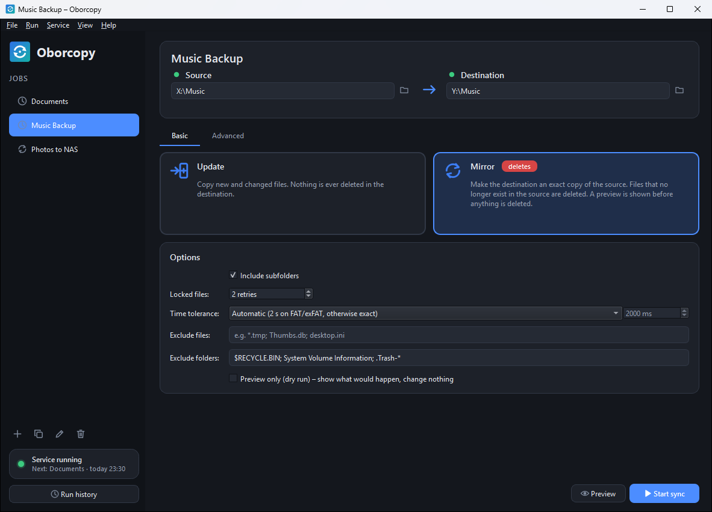

---

## 12. How Oborcopy protects your data

Oborcopy is designed so that a mistake does not destroy your backup:

1. **Look before you act** – everything is compared first; nothing is changed before you start the sync.
2. **Confirmation of deletions** – Mirror mode shows every file that will be deleted and requires your confirmation.
3. **Too-many-deletions warning** – a red warning when an unusually large part of the backup would be deleted.
4. **Empty source protection** – if the source folder is empty (e.g. disk not connected), the sync is stopped.
5. **Folder check** – the destination may not be the same as the source or lie inside it.
6. **No half-copied files** – each file is first written under a temporary name and only renamed when it is complete. Even a power failure leaves no broken files behind.
7. **Archive instead of delete** – optionally, deleted files are kept in `.oborcopy-archive`.
8. **Retries** – files that are briefly in use are tried again automatically.
9. **Logs** – every run is documented.

---

## 13. Questions and troubleshooting

**The first sync takes long – is that normal?**
Yes. The first run copies everything. Later runs only copy changes and are much faster.

**Every sync copies all files again. Why?**
* Check Advanced → *Timestamps & attributes* → **Keep file modification times** is on.
* Keep *Time tolerance* on **Automatic** (needed for FAT/exFAT disks).
* If it happens after the clock change in spring/autumn, turn on **Ignore exact 1-hour differences** (Advanced → Comparison).

**Oborcopy says "The source folder is empty but the destination is not".**
The source disk is probably not connected or the wrong folder is selected. This protection prevents your backup from being wiped. Check the source folder.

**How do I restore files from my backup?**
The backup is a normal folder with normal files – simply copy the files back with Explorer / your file manager. Or create a job with the backup as source and your original location as destination (use **Update** mode to be safe).

**Can I use network drives or a NAS?**
Yes – choose the network folder like any other folder (e.g. `\\nas\backup` on Windows or a mounted share on Linux). *Parallel copies* (Advanced) can make network copies faster.

**I renamed a file only in upper/lower case (e.g. `song.mp3` → `Song.mp3`).**
On Windows this is not treated as a change; the file is not copied again.

**Can I keep using the computer during a sync?**
Yes. Use **Pause** if you need the full disk speed for a moment.

**Linux: "could not load the Qt platform plugin xcb".**
Install the basic graphics libraries of your distribution, e.g. on Ubuntu:
`sudo apt install libgl1 libegl1 libxkbcommon-x11-0 libfontconfig1`

**Where do I find out what happened in an automatic run?**
Open Oborcopy → **Run history** (column *Started by* = **Scheduler**), or the Service Manager → **Last run details** / **Service log**.

**A scheduled backup did not run.**
Check the status pill: the service must be **running** and not paused, and the schedule must be switched **On**. Was the computer off or asleep? Then the job runs after start-up only if *Run a missed backup once after start-up* is ticked. Was the backup disk connected? Tick *Retry if the run fails* so the job tries again a little later. The **Service log** shows every start and its result.

**The Service Manager shows "Windows could not log on the service".**
Your Windows password has changed. Click **Update password…** and enter the new password.

---

## 14. Keyboard shortcuts and version

| Key | Action |
|---|---|
| `F5` | Start sync |
| `F6` | Preview |
| `F7` | Pause / Resume |
| `Shift+F5` | Cancel the running sync |
| `Ctrl+N` | New job |
| `Ctrl+S` | Save job (also happens automatically) |
| `Ctrl+H` | Run history |
| `Ctrl+M` | Service Manager (scheduled backups) |
| `Alt+F4` | Exit (Windows; on Linux also `Ctrl+Q`) |
| `Alt+C`, `Alt+S` | In the confirmation window: tick the check box, start the sync |

### 14.1 Version information

*Help → About Oborcopy* shows the version, the build date and technical details – please include them when you report a problem. *Help → About Developers* shows who built Oborcopy, with links.

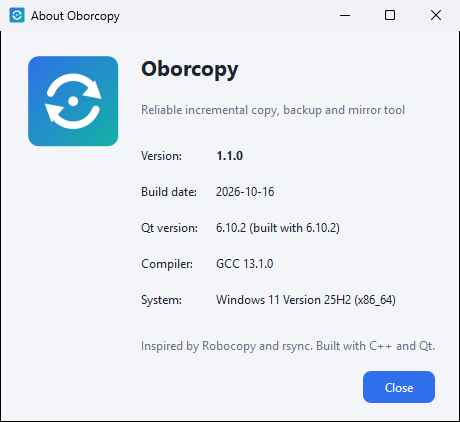


---

## 15. Glossary

| Term | Explanation |
|---|---|
| **Source** | The folder that is backed up. Oborcopy only reads from it (except with *Move files*). |
| **Destination** | The folder that receives the copy. |
| **Job** | Saved settings for one backup task. |
| **Update mode** | Copies new and changed files; never deletes. |
| **Mirror mode** | Makes the destination identical to the source, including deletions. |
| **Preview / Dry run** | Shows what would happen without changing anything. |
| **Extra file** | A file that exists in the destination but not (anymore) in the source. |
| **FAT / exFAT** | File systems used by USB sticks and many external disks; they store file times in 2-second steps. |
| **Time tolerance** | How much file times may differ and still count as equal. |
| **Archive folder** | `.oborcopy-archive` in the destination – receives deleted files if this option is on. |
| **Oborcopy Scheduler** | The background service that runs your jobs at set times, also when Oborcopy is closed. |
| **Log file** | Text file with everything that happened during a run. |

---

<p align="center"><em>Oborcopy 1.1.0 – User Guide</em></p>
